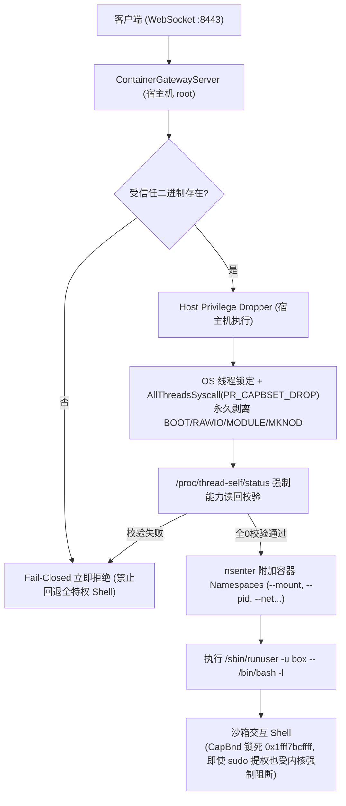

# AttackBox 系统架构规划书 (System Architecture Specification)

## 架构核心定位：纯分布式安全沙箱集群 (Distributed Security Sandbox Cluster)

AttackBox 是一套专为渗透测试人员、安全研究与技术教学打造的高性能分布式容器沙箱基础设施。系统全面采用 **“控制中心 (Control Hub) 与 牺牲品算力节点 (Sacrificial Worker Nodes)”** 的物理与逻辑彻底分离模型：

* **控制端 (Control Server)**: 部署于独立的受保护宿主机，作为系统集中管理大脑，负责 Web 控制台交付、用户认证、算力调度与机密管理。**Control 节点永远不运行任何不受信的沙箱容器，保持绝对安全。**
* **算力节点 (Worker Agent)**: 分布式部署于一组独立的云服务器或物理宿主机上，定位为**“可牺牲的纯算力耗材 (Sacrificial Compute)”**。Worker 节点本地零数据库、无管理控制监听端口、不存储任何系统机密，全面放行特权调试（ptrace）、剥离关机能力（Drop CAP_SYS_BOOT），严防宿主级逃逸以守护多租户底线隔离。被打崩或受污染时，通过底层云快照秒级回滚自愈。
* **极简原则 (YAGNI)**: 当前迭代严守精简边界，彻底剥离未规划的计费、邀请体系以及未上线的复杂靶机编排，聚焦于容器沙箱的高并发调度、内核特权防御与高吞吐交互。

---

## 目录索引 (Table of Contents)

* **第 1 章：系统分布式拓扑与 C/S 通信模型**
  * 1.1 分布式集群拓扑与节点角色定位
  * 1.2 牺牲品节点安全哲学 (Sacrificial Node Philosophy)
  * 1.3 双通道解耦机制 (反向长连接控制信道 vs 边缘直连数据信道)
* **第 2 章：Worker 沙箱核心运行时与特权放行规范**
  * 2.1 Btrfs 原生瞬态子卷快照与毫秒级派生机制
  * 2.2 Linux Namespaces 隔离、/proc/self/exe 自引导与 CLONE_INTO_CGROUP 机制
  * 2.3 物理资源配额与防 DoS 约束 (Cgroups v2 内存/进程/IO 限额与一次性初始化)
  * 2.4 沙箱特权放行与 P0-A 级逃逸防御规范 (宿主机可信特权剥离 / Bounding Set 全线程广播)
  * 2.5 销毁流水线状态保留与有界退出 (后删状态 / 5s 上下文超时)
* **第 3 章：双模交互引擎实现规范**
  * 3.1 PTY 远程命令行 (CLI) 桥接方案与自适应 Resize
  * 3.2 TigerVNC 远程桌面 (GUI) 按需加载与 Unix 套接字直通
* **第 4 章：沙箱单网桥网络隔离与槽位调度**
  * 4.1 虚拟专用网桥拓扑 (`br-attackbox`)
  * 4.2 沙箱二层端口隔离 (Bridge Port Isolation 防 ARP 欺骗与横向嗅探)
  * 4.3 WAN 出口白名单与控制面防回环规则
  * 4.4 批处理网络配置与 Fork 风暴消除
  * 4.5 SlotAllocator 槽位安全分配与防重调度
* **第 5 章：Control 凭据认证、状态模型与安全追溯**
  * 5.1 数据持久化定位与 WAL 并发连接池 (16 并发读)
  * 5.2 基于 Ed25519 的客户端无状态 JWT 鉴权与 TokenVersion 实时注销
  * 5.3 认证防时序侧信道、错误脱敏与 Admin 自动引导
  * 5.4 攻防沙箱安全责任追溯机制
* **第 6 章：分布式控制调度、数据流接入与会话生命周期**
  * 6.1 集中调度与管理员权威策略控制 (废除用户自定义策略 / 零配置 Fail-Closed)
  * 6.2 Ed25519 跨机能力凭证 (Ticket) 与 Worker 零 DB 离线验签
  * 6.3 交互会话并发控制与状态保活 (CLI/GUI 统一单活跃抢占机制)
  * 6.4 防 TOCTOU 并发双击预占与单路径终止
  * 6.5 真实系统内核遥测采样 (/proc/meminfo 与 /proc/loadavg)
* **第 7 章：节点全生命周期管理、网络重连与传输层防护**
  * 7.1 节点生命周期状态机 (Online, Draining, Offline, Resetting)
  * 7.2 节点重连连接解耦 (防旧连接退出误注销新连接)
  * 7.3 并发数据竞争防护 (ContainerGatewayServer 读写锁治理)
  * 7.4 传输层 DoS 拦截 (MaxHTTPPayloadSize 与 MaxWebSocketMessageSize)
  * 7.5 HTTP 生产级观测性、链路追踪与 Panic 恢复中间件
  * 7.6 节点心跳同步与会话自动清理
  * 7.7 单沙箱独立邮箱与串行顺序保障 (容量 4 满列即拒杜绝丢包挂起)
* **第 8 章：系统配置与凭据隔离**
  * 8.1 静态配置文件规范
  * 8.2 核心机密单向隔离与无状态 Worker
* **第 9 章：实例权威状态模型与生命周期规范**
  * 9.1 单一权威记录原则 (Worker 独占维护与只读快照)
  * 9.2 纯事件驱动资源回收 (零定时器 / 心跳差异与重启清算)
  * 9.3 统一销毁与幂等收敛 (单下线管线与错误保留)
  * 9.4 无状态运行与秒级启动 (零磁盘扫描)

---

## 第 1 章：系统分布式拓扑与 C/S 通信模型

```
                               ┌────────────────────────────────┐
                               │       Control 管理中心节点       │
                               │  (独立物理机 / 云 VPS, 端口:443)  │
                               │                                │
                               │ • 独占全局持久化 SQLite (WAL)   │
                               │ • SQLite WAL 级极速用户鉴权     │
                               │ • 静态金库: API Key / 签名私钥  │
                               │ • 集中算力调度与管理员策略下发   │
                               │ • 事件驱动会话与槽位生命周期管理│
                               └───────────────┬────────────────┘
                                               ▲
                            跨公网 WSS 反向控制信道 (带保活与心跳)
                                               │
             ┌─────────────────────────────────┼─────────────────────────────────┐
             │                                 │                                 │
             │                                 │                                 │
             ▼                                 ▼                                 ▼
  ┌───────────────────────┐         ┌───────────────────────┐         ┌───────────────────────┐
  │   Worker 算力节点 1    │         │   Worker 算力节点 2    │         │   Worker 算力节点 N    │
  │   (Sacrificial Node)  │         │   (Sacrificial Node)  │         │   (Sacrificial Node)  │
  │                       │         │                       │         │                       │
  │ • 零 DB / 零用户数据   │         │ • 零 DB / 零用户数据   │         │ • 零 DB / 零用户数据   │
  │ • 仅开数据端口 :8443  │         │ • 仅开数据端口 :8443  │         │ • 仅开数据端口 :8443  │
  │ • Btrfs 原生子卷快照  │         │ • Btrfs 原生子卷快照  │         │ • Btrfs 原生子卷快照  │
  │ • 宿主机特权剥离执行器│         │ • 宿主机特权剥离执行器│         │ • 宿主机特权剥离执行器│
  │ • 纯内存离线验签Ticket│         │ • 纯内存离线验签Ticket│         │ • 纯内存离线验签Ticket│
  └───────────┬───────────┘         └───────────┬───────────┘         └───────────┬───────────┘
              ▲                                 ▲                                 ▲
              │                                 │ 浏览器直连 Worker 数据端口      │
              │                                 │ (不经 Control 中转, :8443)       │
              └─────────────────────────────────┼─────────────────────────────────┘
                                                │
                                      ┌─────────┴─────────┐
                                      │   用户浏览器终端   │
                                      │ (xterm.js / noVNC)│
                                      └───────────────────┘
```

### 1.1 分布式集群拓扑与节点角色定位
系统严格划分为两端：
* **Control 服务端 (Control Hub)**:
  * **角色定位**: 集中式有状态管理中心（Stateful Management Hub）。
  * **职责范围**:
    1. 独占 SQLite 数据库，全生命周期托管核心用户认证、令牌版本控制与操作审计日志。
    2. 维持全集群 Worker 反向连接池，统筹全局算力负载均衡与实例调度。
    3. 维护 `SessionManager` 与内存槽位分配器，执行原子预占防并发双击。
    4. 纯事件驱动维护全局槽位池与单用户并发锁，根据心跳差异与节点断线即时释放资源。
    5. 集中保管 Ed25519 签名私钥，分发跨机验签公钥与临时 Ticket。
* **Worker 客户端 (Worker Agent / Node)**:
  * **角色定位**: 分布式无状态牺牲品执行器（Stateless Managed Executor）。
  * **职责范围**:
    1. 100% 遵从 Control 下发的调度指令，负责本地 Btrfs 瞬态快照派生/销毁、单网桥隔离接入、Cgroups v2 配额限制与沙箱生命周期管理。
    2. 负责 PTY 伪终端主从对管理、TigerVNC 桌面按需拉起及本地 Unix Domain Socket 数据流桥接。
    3. 本地持有从 Control 同步的 Ed25519 公钥，进行纯内存极速离线验签，核销 JTI 防重放。
    4. 动态采集真实宿主机 `/proc/meminfo` 与 `/proc/loadavg` 指标并按期向控制中心上报。
    5. 独占负责沙箱硬超时（TTL）与闲置超时（Idle）的权威判定与本地清理销毁。

### 1.2 牺牲品节点安全哲学 (Sacrificial Node Philosophy)
将算力节点定位为“牺牲品（Sacrificial Node）”是本架构的核心安全基石：
1. **物理隔离保护大脑**: Control 永远不与沙箱共处于同一台机器。即使沙箱被利用打穿至宿主机 root 甚至污染内核，受害范围被严格限制在该单一 Worker 物理机/虚拟机内，Control 的用户数据、数据库和系统机密毫发无损。
2. **出厂级瞬时恢复**: 一旦 Worker 被恶意篡改或测试损坏，管理员通过 Web 界面一键触发云底座 API 执行整机纯净快照回滚重建，秒级回归初始状态。

### 1.3 双通道解耦机制 (Control Channel vs Data Channel)
* **控制信道 (Control Channel - 反向长连接)**:
  * Worker 启动后作为客户端，主动通过 WebSocket (`wss://control.example.com/api/agent/connect`) 反向连接 Control 中心。
  * Worker 节点无需对外开放任何管理或 SSH 端口，天然免疫来自公网的直接扫描与暴破。
  * 承载流量：节点握手注册、周期心跳遥测、沙箱调度创建/销毁指令、安全策略下发。
  * **单沙箱独立 FIFO 邮箱与全局锁解耦 (P1-D 级加固)**: Worker 接收控制消息后，基于沙箱 ID 维护独立缓冲队列（`sandboxMailbox`，容量 64）。查询或初始化邮箱后立即释放全局互斥锁 `mailboxesMu`，在锁外执行非阻塞投递；即使单一沙箱出现极端积压或卡顿，全局互斥锁持有时间严格保持在纳秒级，杜绝控制通道全局停摆与其它沙箱级联超时。
* **数据信道 (Data Channel - 客户端直连 Worker 数据端口)**:
  * 各 Worker 仅开放单一公网端口 `:8443`。
  * 用户浏览器从 Control 取得合法的临时访问 Ticket 后，直接与沙箱所在的 Worker `:8443` 建立 WebSocket 直连，全程不经 Control 中转。
  * 海量高并发的 CLI 字符流与 VNC RFB 桌面图像流由客户端与 Worker 点对点传输，Control 节点的网络带宽绝不成为系统瓶颈。

---

## 第 2 章：Worker 沙箱核心运行时与特权放行规范

### 2.1 Btrfs 原生瞬态子卷快照与毫秒级派生机制
* **核心选型考量 (为什么坚持 btrfs 原生快照而拒绝 OverlayFS)**:
  1. **杜绝双重 CoW 损耗**: 在本身就是写时复制（CoW）的 btrfs 宿主上叠挂一层 OverlayFS 会导致双重 CoW 与双重元数据寻址，拖慢 I/O 吞吐并产生大量磁盘碎片。
  2. **100% 纯正 POSIX 语义与黑客工具兼容**: OverlayFS 存在跨层目录重命名报错 `EXDEV`、inode 动态变化等非标准 POSIX 行为；而 btrfs subvolume 快照在内核中是一个原生的标准根文件系统，GDB、Wireshark、Metasploit、Ghidra 等底层攻防工具零兼容报错。
  3. **零物理磁盘冗余**: 利用 btrfs 底层 extent 引用计数，直接秒级从母机只读模板快照克隆，创建耗时 `< 1ms`，物理磁盘占用为 0 字节。
* **实现原理与分层拓扑**:
  1. **只读基准脱敏金盘 (Golden Base - `base_rootfs`) 与原子发布 (P0 级加固)**:
     Worker 启动时检查 `/var/lib/attackbox/base_rootfs`；若不存在，一次性从宿主机根目录 `/` 派生基准子卷。为防止沙箱内部提权用户读取宿主敏感凭据并伪造 Worker 身份冒充集群节点，金盘构建流水线在快照后执行严格的无死角脱敏名单：
     * **集群配置与凭据彻底清除**: 移除 `/etc/attackbox/*`、`/var/lib/attackbox/secrets*`、`/var/lib/attackbox/worker.yaml`、`/var/lib/attackbox/node.yaml`；
     * **TLS 私钥与 SSH 主机密钥消除**: 移除 `/etc/ssl/private/*`、`/etc/ssh/ssh_host_*`；
     * **云厂商凭据与 VPN 秘钥擦除**: 移除 `~/.aws`、`~/.kube`、`/etc/wireguard`、`/var/log/*` 等；
     * **构建原子性保障与完成标志**: 金盘构建采用临时目录（`base_rootfs.building`）+ `/etc/.attackbox_golden_ready` 完成标志文件 + Btrfs 只读锁定验证（`ro=true`），校验无误后通过原子重命名切换为生产 `base_rootfs`，杜绝快照中途崩溃导致残缺半成品金盘被误用的风险。
  2. **毫秒级可写瞬态子卷派生 (Transient Snapshot)**:
     调度器分配沙箱时，Worker 秒级从只读基准子卷派生独立的可写子卷：
     ```bash
     btrfs subvolume snapshot /var/lib/attackbox/base_rootfs /var/lib/attackbox/instances/<sandbox_id>/rootfs
     ```

### 2.2 Linux Namespaces 隔离、/proc/self/exe 自引导与 CLONE_INTO_CGROUP 机制
沙箱启动时强制启用核心命名空间：
* `CLONE_NEWPID`: 进程隔离，沙箱内无法观测宿主机进程，内部首进程 PID 为 1。
* `CLONE_NEWNS`: 挂载点隔离，通过 `pivot_root` 彻底将实例 rootfs 替换为根目录，隔离宿主文件系统。
* `CLONE_NEWUTS`: 隔离主机名，沙箱内拥有独立的主机标识。
* `CLONE_NEWIPC`: 隔离 IPC 消息队列与共享内存。
* `CLONE_NEWNET`: 隔离网络命名空间。
* **原生 CLONE_INTO_CGROUP 特性**:
  通过 Linux 5.7+ 原生系统调用标志，在子进程诞生的首个时钟周期即原子放入目标 Cgroup，彻底消除传统“先 fork 再写 cgroup.procs”带来的微秒级 Fork 炸弹逃逸窗口。

### 2.3 物理资源配额与防 DoS 约束 (P1-C 级深度加固)
* **Cgroups v2 严格 Fail-Closed 与配额写后回读校验**:
  - `memory.max`: 管理员下发或默认保底为 2048MB（严禁写入 `max` 导致无限滥用）。
  - `memory.swap.max`: 强制锁定为 0，杜绝 Swap 抖动击穿宿主磁盘。
  - `pids.max`: 默认保底为 512，防范 Fork 炸弹。
  - `cpu.weight`: 默认设置为 100，实行 CPU 调度公平分享。
  - **写后回读核实 (Write-then-Readback)**: 禁止将“具有默认数字”视作“内核已经生效”。所有控制器委派、内存上限、进程数上限和 CPU 权重写入均进行写后回读对比核验；若读回值与目标值不一致或写入报错，立即触发原子回滚销毁该 Cgroup 目录并拒绝启动沙箱，杜绝产生逃脱资源约束的“幽灵沙箱”。
  - **I/O 限额物理全盘设备号解析与单行复合写入**: 针对 Btrfs 虚拟文件系统在 mountinfo 中报告匿名设备号（`0:X`）导致内核报 `no such device` 的问题，系统通过解析挂载源并展开 sysfs 块设备软链接（`/sys/class/block/<dev>/partition` 与 `../dev`），精准获取底层物理全盘设备号（如 `254:0`）；同时针对 Cgroup v2 `io.max` 多次写入覆盖未提及字段的特性，采用单行复合原子写入规范（`254:0 wbps=N wiops=M`）并回读校验，杜绝参数静默失效。
* **Cgroup 父级控制器委派强校验 (`EnsureParentHierarchy`)**:
  通过 `sync.Once` 保护基准层级初始化。针对系统根 `/sys/fs/cgroup` 与 `$CgroupRoot` 激活控制器，并**强制回读 `$CgroupRoot/cgroup.subtree_control` 验证必须的核心控制器（`memory` 与 `pids`）是否成功委托**。若因 systemd 抢管或内核配置导致关键控制器缺失，启动阶段立即 Fail-Closed 阻断，坚决杜绝在无资源管控能力的节点上派发沙箱。
* **宿主机全局磁盘水位熔断 (Disk Guard)**:
  Worker 后台协程周期性监控物理存储空间。当空闲容量跌破安全阈值时，自动熔断拒绝新建沙箱，杜绝宿主机磁盘触发 `ENOSPC` 故障。

### 2.4 沙箱特权放行与 P0-A 级逃逸防御规范
针对租户在沙箱内拥有 `sudo` 权限的攻防场景，系统确立了**“宿主机可信特权剥离”**与**“Fail-Closed 阻断机制”**：



1. **宿主机端特权剥离执行**:
   网关启动交互 PTY 时，特权剥离逻辑由宿主机受信任入口负责（`/usr/local/bin/attackbox-enter` 或宿主运行中的单二进制 `__enter__`），**绝不调用沙箱内部可写快照中的任何可执行文件**。
2. **Fail-Closed 绝不回退**:
   若宿主机特权剥离程序无法解析，网关直接拒绝建立连接，**严禁回退执行无特权限制的 root 终端 Shell**。
3. **CGO 环境单线程降权锁定与能力读回校验 (P1 级加固)**:
   针对 CGO 链接二进制下 `AllThreadsSyscall` 返回 `ENOTSUP` 的特性，系统引入全流程 OS 线程锁定：
   * 执行能力剥离前强制调用 `runtime.LockOSThread()`，直至 `execve` 替换进程映像，确保能力更改与环境附加始终锁定在同一物理 OS 线程；
   * 在进入沙箱前，读取 `/proc/thread-self/status`，严格核实四项敏感能力（`CAP_SYS_BOOT`、`CAP_SYS_RAWIO`、`CAP_SYS_MODULE`、`CAP_MKNOD`）对应的比特位全部归零；
   * 任何降权失败或能力读回非零，立即无条件阻断连接并拒绝进入。
4. **沙箱镜像纯净无注入**:
   彻底清除金盘构建阶段对沙箱内 `/usr/bin/attackbox-enter` 的文件注入逻辑，沙箱内部无需驻留任何定制特权剥离工具。

### 2.5 销毁流水线状态保留与有界退出 (端到端 P1-A 闭环原则)
为避免销毁阶段因 D 状态进程挂死或网络中断导致孤儿泄漏与槽位冲突，系统在 Worker 与 Control 两端严格实行**“后删状态”与“有界等待”**闭环：
1. **进程有界等待**: 调用 `cmd.Wait()` 时配置 5s Context 超时保护，超时后向进程组强制发送 `SIGKILL`，杜绝销毁协程无限挂起。
2. **挂载点安全卸载**: 调用 `mountpoint -q` 检查并执行 `umount -l`，聚合记录挂载清理结果。
3. **微秒级销毁退避**: 在 `cgroup_v2_controller.Destroy` 中引入 `isCgroupEmpty`，优先检测 `cgroup.events`（`populated 0`），配合 2ms 指数退避，消除了每 50ms 读文件的粗暴轮询。
4. **端到端后删状态原则 (彻底根除 P1-A 冲突)**:
   * **Control 端状态机严格驱动**: 会话引入明确的生命周期状态 `creating` -> `running` -> `terminating` -> `terminated`（异常时置为 `cleanup_failed`）；
   * **先发 RPC，确认成功后放槽位**: 终止沙箱时，Control 先将会话置为 `terminating`，向 Worker 派发 `DestroyBox` 指令，**仅当 Worker 节点确认返回成功后**，Control 才将状态置为 `terminated`、注销会话并将 IP 槽位归还给 Free List；
   * **失败锁定，杜绝网卡与 IP 抢占冲突**: 若因 Worker 离线、超时或底层清理失败，Control 将会话转入 `cleanup_failed` 状态并保留在系统中，**绝对不提前释放槽位**，杜绝因过早释放槽位导致的新建沙箱与旧沙箱 IP 碰撞及网卡互拆风险；残留实例交由后台巡检机制持续跟进重试或对账。

---

## 第 3 章：双模交互引擎实现规范

### 3.1 PTY 远程命令行 (CLI) 桥接方案与自适应 Resize
* **实现基石**: 基于 Linux 原生伪终端（PTY）主从设备机制（`/dev/ptmx` 与 `/dev/pts/*`）。
* **进程进入与数据桥接流水线**:
  1. Worker 接收到建立 CLI 终端连接的 WebSocket 握手并验证 Ticket。
  2. Worker 打开宿主 PTY 主从对 (`ptmx, pts`)。
  3. 执行受信任特权剥离执行器附加至目标沙箱命名空间，并将 PTS 重定向为 Shell 的输入输出。
  4. 将启动的进程 PID 绑定至该沙箱的 Cgroup。
  5. 协程监听 `ptmx` 输出并以 WebSocket 二进制帧推流给前端；同时将用户击键字符流写入 `ptmx`。
* **窗口动态自适应 (Resize)**:
  前端 xterm.js 窗口缩放时投递 JSON 控制帧，Worker 解析后调用底层 `pty.Setsize` 触发 `SIGWINCH` 信号，使终端布局自适应。

### 3.2 TigerVNC 远程桌面 (GUI) 按需加载与 Unix 套接字直通
* **按需拉起**: 用户仅打开 CLI 终端时绝不启动图形进程；点击“打开桌面”时按需触发 `EnsureGUI(sandbox_id)`。
* **Unix Domain Socket 直通**:
  TigerVNC 服务强制仅监听本地 Unix Domain Socket（如 `/run/attackbox/<sandbox_id>/gui.sock`），对外不开放任何 TCP 端口，全双工桥接用户 WebSocket 数据流。

---

## 第 4 章：沙箱单网桥网络隔离与槽位调度

### 4.1 虚拟专用网桥拓扑与实例绑定网卡命名
Worker 节点内部构建单一私有虚拟网桥：
* **网段规划**: `10.200.0.0/16`，宿主网关：`10.200.0.1`。
* **实例绑定网卡命名 (消除 veth 互拆冲突)**:
  为彻底根除固定按槽位命名（如 `vh<N>`）导致新旧沙箱在快速销毁/重建时互相拆卸对方网卡的竞态风险，虚拟网卡命名采用实例绑定算法 `VethNameForSandbox(slot, sandboxID)`：
  - 宿主端网卡名生成为 `vh<slot>_<sandboxID[:8]>`（如 `vh1_40f5569d`，严格控制在 Linux 内核 15 字符以内）；
  - 容器端网卡名生成为 `vb<slot>_<sandboxID[:8]>` 并在进入容器命名空间后原子重命名为 `eth0`；
  - 销毁与卸载操作严格按照沙箱 ID 定向精确清理，杜绝因槽位复用引发的网络通信中断与误删。
* **分段 IP 映射算法 (杜绝 .256 越界)**:
  槽位与 IP 映射采用子网分段算法：`10.200.(slot-1)/240.(10+(slot-1)%240)`。当槽位达到 240-250 范围时，自然进位至下一网段，从数学上彻底根除产生 `.256` 非法 IP 的 Bug。

### 4.2 沙箱二层端口隔离 (Bridge Port Isolation)
* **二层端口隔离标志**: 宿主端虚拟网卡挂载到网桥时，强制开启端口隔离：
  ```bash
  ip link set vh<slot> type bridge_slave isolated on
  ```
  内核强制拦截所有标记为 `isolated on` 端口之间的二层通信（ARP 广播、单播等），彻底免疫沙箱间的 ARP 欺骗与横向嗅探。

### 4.3 WAN 出口白名单与控制面防回环规则
* **外网严格放行核心端口**: nftables 仅放行 DNS (`UDP 53`)、HTTP (`TCP 80`)、HTTPS (`TCP 443`)，其余外网流量全数丢弃。
* **阻断控制面与内部回环**: 严格阻断沙箱访问 Worker 本地回环（`127.0.0.1/8`）及向 Control 控制信道端口发起探测。

### 4.4 批处理网络配置与 Fork 风暴消除
沙箱内部网络配置（网卡重命名为 `eth0`、分配 IP、启动网卡、启用 Loopback 及配置默认网关）由单次原子 Shell 脚本批处理调用完成，将外部进程派生次数从原本的 10 余次收敛至极简，消除频繁 fork 对内核调度造成的冲击。

### 4.5 SlotAllocator 槽位安全分配与防重调度
在 Control 节点中，网络槽位分配器优先保障数据一致性与零泄漏：
* **单一事实来源**: 采用双向映射表（`slotToID map[int]string` 与 `idToSlot map[string]int`），彻底废除切片自由列表，杜绝多重数据结构状态不同步风险。
* **分配与释放**: 顺序检索 1~250 槽位分配首个空闲序号（纳秒级完成），释放时双向抹除，从机制上杜绝槽位泄漏与重复分配。

---

## 第 5 章：Control 凭据认证、状态模型与安全追溯

### 5.1 数据持久化定位与 WAL 并发连接池 (16 并发读)
Control 节点独占 SQLite 数据库（`attackbox.db`），强制启用 WAL 模式并发优化：
```
sqlite3://attackbox.db?_journal_mode=WAL&_busy_timeout=5000
```
连接池配置放宽至 `SetMaxOpenConns(16)` 与 `SetMaxIdleConns(8)`，允许多个只读请求并发穿透，彻底消除单连接瓶颈。

### 5.2 基于 Ed25519 的客户端无状态 JWT 鉴权与 TokenVersion 实时注销
* **JWT 签名**: 采用 Ed25519 纯内存签名，有效载荷包含 `sub`、`username`、`role`、`ver`、`exp`。
* **实时版本校验**: 鉴权中间件直接比对 SQLite 用户主键记录中的 `TokenVersion` 与用户状态（微秒级 WAL 索引查询），密码变更或管理员注销时瞬时全局生效，杜绝缓存击穿与双端失效竞态。

### 5.3 认证防时序侧信道、错误脱敏与 Admin 自动引导
1. **时序侧信道消除**: 用户登录验证时，无论用户名是否存在，均无条件执行一次耗时恒定（~83ms）的 Dummy Bcrypt 比较运算，抹平用户名枚举攻击面。
2. **报错脱敏**: 数据库主键与唯一索引冲突等底层错误拦截脱敏为统一文本（`username or email already registered`），严防内部表结构泄露。
3. **Admin 引导闭环**: 支持通过配置文件预设初始管理员，并在首位用户注册时自动提权至 `role='admin'`，确立系统管理权限的自然闭环。

### 5.4 攻防沙箱安全责任追溯机制
1. **统一标识与审计**: 用户分配全局唯一 `uid`，沙箱分配 `sandbox_id`，关键生命周期流转记录入 `audit_logs` 表。
2. **操作责任闭环**: 针对登录鉴权、沙箱派发与终止、违规访问拦截等关键事件持久化存储，满足合规审查需要。

---

## 第 6 章：分布式控制调度、数据流接入与会话生命周期

### 6.1 集中调度与管理员权威策略控制
* **废除用户传参策略**: `StartSandboxReq` 变更为纯空结构体 `{}`，普通租户绝对禁止自定义内存与 CPU 策略。
* **管理员权威配置**: 沙箱物理限制严格遵循 Control 配置文件由管理员统一制定，通过 RPC 指令权威下发至 Worker 节点。
* **Fail-Closed 兜底**: 若配置参数缺失或出现零值，控制端与底层驱动严格采用安全兜底限制（2048MB 内存、512 进程），绝不生成无限制沙箱。

### 6.2 Ed25519 跨机能力凭证 (Ticket) 与 Worker 零 DB 离线验签
* **Ticket 载荷**: 包含 `jti`、`sub`、`sbx`、`typ`、`exp`（60秒内有效）。
* **纯内存离线验签**: Worker 使用预置的 Ed25519 公钥本地完成数学验签（耗时 `< 0.1ms`），并通过 JTI 过滤器防止重放攻击。

### 6.3 交互会话并发控制与状态保活
* **单活跃抢占机制**: 针对同一沙箱的 PTY 或 VNC 连接，Worker 维护单活跃会话表。若新连接接入，主动向旧连接发送 `4001 Preempted` 控制帧优雅关闭旧通道，确保单终端输入的时序一致性。
* **真实击键活跃保活 (`TouchSandbox`)**: 废除轮询查询接口（如 `/api/sandbox/active`）无差别刷新活跃时间的做法（防止监控轮询导致沙箱永不超时）。系统仅在用户向 PTY 终端实际输入击键字符流时触发 `TouchSandbox`，真实反映租户活跃状态。

### 6.4 防 TOCTOU 并发双击预占与单路径终止
* **原子预占 (`TryReserve`)**: `SessionManager` 在收到创建请求时立即实施基于用户 ID 的内存原子锁，快速并发双击请求首发返回 `201 Created`，次发精准返回 `409 Conflict`，杜绝旧沙箱失控漂移。
* **单路径终止流水线**: 用户主动停止与销毁请求统一流经单一下线管线，保证流程无分叉与状态自洽。

### 6.5 真实系统内核遥测采样
Worker 节点通过读取 `/proc/meminfo`（`MemTotal` 与 `MemAvailable`）和 `/proc/loadavg` 获取微秒级真实的物理系统指标，向 Control 心跳上报诚实数据，彻底废除一切伪造标记与硬编码数值。

---

## 第 7 章：节点全生命周期管理、网络重连与传输层防护

### 7.1 节点生命周期状态机与动态调度过滤 (P1-E 级加固)
* `Online`: 节点心跳正常（默认 3 秒采样一次），进入集群最少负载调度池（Least-Connections）。
* `Draining`: 节点处于排空维护期，仅运行存量沙箱，调度器 `SelectBestWorker()` 严格跳过该节点，不派发任何新建沙箱。
* `Offline`: 连续超时未上报心跳（默认 15 秒），状态自动置为 Offline，彻底剔除出调度队列。
* `Resetting`: 节点正在执行底层云快照回滚重建，严禁接收任何新建请求。
* **状态机流转与查询**: 集群管理器提供线程安全的 `SetNodeState` 与 `GetNodeState` 接口，在 `GetSchedulingSnapshot` 单次读锁内原子获取节点状态、最新心跳与负载，消除多重锁竞争开销。

### 7.2 节点重连连接解耦
节点注销采用连接实例指针严格判等：当节点发生快速重连时，旧连接退出触发的断开动作绝不误注销已建立的新连接。

### 7.3 并发数据竞争防护与 WebSocket 抢占优化
* **网关公钥读写锁**: 在 [`node/container_gateway_server.go`](file:///F:/deepseek/attackbox/node/container_gateway_server.go) 中，网关持有的 Ed25519 公钥通过 `keyMu sync.RWMutex` 进行读写保护，`SetPublicKey` 上写锁，客户端交互端上读锁，经受 `go test -race` 高并发压测保证零报警。
* **抢占关闭移出全局互斥锁**: `GatewaySessionManager.RegisterCLI` 将慢连接的 `WriteControl` 与 `Close` 移至锁外异步执行，彻底杜绝慢客户端断连导致全局 session 锁阻塞数十毫秒的隐患；同时封装 `SafeConn`，在底层实现 `recover()` 拦截机制，提供完备的 nil-safety 容错保护。

### 7.4 传输层 DoS 拦截
* **HTTP Body 限制**: 全局应用 `http.MaxBytesReader` 限制 1MB（`protocol.MaxHTTPPayloadSize`），超大报文精准拦截并返回 `HTTP 413 StatusRequestEntityTooLarge`。
* **WebSocket 帧限制**: 控制面设置 `SetReadLimit(1MB)`，数据面 PTY 设置 `SetReadLimit(64KB)`，超大恶意数据帧触发底层强制断开连接。

### 7.5 HTTP 生产级观测性、链路追踪与 Panic 恢复中间件
* **状态码拦截**: 实现 `statusResponseWriter` 拦截并记录 HTTP 响应状态码，同时原生实现 `http.Hijacker` 与 `http.Flusher`，保障 WebSocket 升级协议顺畅穿透。
* **全链路请求 ID**: 自动生成或透传 `X-Request-ID`，注入请求 Context 与响应头。
* **全局 Panic 恢复**: `recoveryMiddleware` 拦截意外 panic，打印堆栈并输出标准 500 JSON 错误。
* **统一日志格式**: 废除分散的 `fmt.Printf`，全量统一为标准库 `log.Printf`。

### 7.6 节点心跳同步与会话自动清理
* **心跳上报**: Worker 周期性向 Control 上报节点启动标识与实际运行中的沙箱快照清单（包含真实终端交互时间戳）。
* **重启清算**: Control 检测到 Worker 启动标识发生变更时，判定节点已发生重启，立即注销该节点原先登记的所有沙箱会话并释放槽位。
* **缺失释放**: Control 以 Worker 心跳清单为准进行单向核对：未出现在清单中的沙箱判定为已终止，即时释放 IP 槽位并解除租户并发占用；在清单中的沙箱则同步最新活跃时间。

### 7.7 单沙箱独立邮箱与串行顺序保障
Worker 针对每个沙箱维护独立的 FIFO 处理邮箱，确保单实例命令严格按序执行：
* **顺序执行保证**: 同一沙箱的创建与销毁指令严格串行化执行，杜绝并发竞争与状态穿插。
* **满队列明确拒绝**: 当单沙箱操作队列满（容量 4）时，立即发回明确拒绝响应，杜绝静默丢弃导致控制端超时挂起。
* **生命周期自然终结**: 销毁命令执行完毕且无后续指令时，处理协程安全退出并清理映射，消除空闲超时竞态。

---

## 第 8 章：系统配置与凭据隔离

### 8.1 静态配置文件规范与 YAML 强类型解析 (P1/P2 级加固)
* **配置文件职权分离与彻底解耦**:
  * **Control 配置文件 (`configs/control.yaml`)**:
    * 集中管理：Web 监听端口、CORS 白名单、SQLite 路径、集群密钥 `cluster_secret`、签名私钥、超时与生命周期参数（`ttl_seconds`、`idle_seconds`）、超级管理员引导凭据（`initial_admin_*`）及全局沙箱权威配额（`resources`、`storage`）；
    * **彻底剔除无用网络配置**: 移除历史残留的 `sandbox.network`（网桥与子网由 Worker 本地管理），Control 纯粹按 Slot 整数进行资源追踪与会话维护；
  * **Worker 配置文件 (`configs/node.yaml`)**:
    * 包含：节点身份标识（`node_id`）、集群通信密钥、Control 反向连接地址、数据服务端口（`:8443`）、本地 Btrfs/Cgroup/DiskGuard 路径与本地网桥网络配置（`network: bridge_name, gateway_ip, subnet_cidr, egress_interface`）；
* **YAML KnownFields(true) 严格校验与别名智能兼容**:
  * 全局解析器启用 `decoder.KnownFields(true)`：严禁任何拼写错误或废弃键混入配置，遇到未知键立即阻断报错；
  * 智能兼容存储别名：支持通过自定义 Unmarshal 解析 `tmp_size`/`tmpfs_tmp_size` 与 `run_size`/`tmpfs_run_size`。

### 8.2 核心机密单向隔离与无状态 Worker
* **私钥留底，公钥下发**: Control 独占持有签名私钥，Worker 仅持有公钥用于离线验签。Worker 即使遭到逆向或内存 Dump，也绝无法伪造合法的系统访问 Ticket。
* **Worker 物理零机密、零数据库**: Worker 本地无持久化数据库，受害面严格锁死在该牺牲品节点内部，保障中心控制资产绝对安全。

---

## 第 9 章：实例权威状态模型与生命周期规范

### 9.1 单一权威记录原则 (Worker 独占维护与只读快照)
* **权责划分**: Worker 维护实例运行的唯一权威状态（包含运行进程、网络分配、生命周期时间戳与清理状态）；Control 仅维护面向用户的调度与归属信息，下达创建与停止指令。
* **生命周期独占判定**: Worker 独占负责实例硬超时（TTL）与闲置超时（Idle）的权威判断与销毁执行。Worker 能够感知底层伪终端的真实输入流，断开 Control 连接后亦能自主回收，杜绝双端各自计时导致的误杀与竞态冲突。
* **只读快照消费**: 外部通信通道与数据网关仅能读取 Worker 实例的只读数据快照，严禁跨组件交叉读写或多头维护状态。
* **真实击键活跃**: 终端实际交互直接原地刷新 Worker 权威活跃时间戳，杜绝任何外部轮询查询伪造活跃。

### 9.2 纯事件驱动资源回收 (零定时器 / 心跳差异与重启清算)
Control 端彻底剔除周期性定时扫描器（零定时器），完全基于 Worker 真实心跳事件驱动全局资源的收敛与回收：
* **心跳差异回收**: 以 Worker 周期心跳上报的存活实例清单为准进行单向核对，未在清单中的实例即时从会话表移除并归还 IP 槽位。
* **节点重启清算**: 节点启动标识（BootID）发生变更表明算力节点已重启，Control 立即清空旧会话并归还槽位。
* **排他性硬资源解冻**: 及时解除单用户单实例排他锁（防止用户被幽灵实例卡死），并及时归还全局有限的 IP 槽位池（防止槽位耗尽导致拒绝服务）。

### 9.3 统一销毁与幂等收敛 (单下线管线与错误保留)
* **单路径销毁**: 用户主动停止、Worker 超时自动回收及创建失败回滚，统一流经单一下线管线，串行安全释放进程、网络、挂载与隔离资源。
* **幂等收敛**: 目标为销毁的请求，若实例在内存中已不存在直接认定成功；清理完全成功后移出内存，清理若遇异常则保留错误标记供排查与重试。

### 9.4 无状态运行与秒级启动 (零磁盘扫描)
* **天然隔离**: 沙箱使用高熵唯一标识，目录与网卡按规则动态派生，实例之间互不冲突。
* **零扫描就绪**: Worker 定位为可牺牲算力，启动时不扫描磁盘、不尝试复活旧实例，内存开局秒级就绪；正常生命周期由守护进程退出钩子托管。
