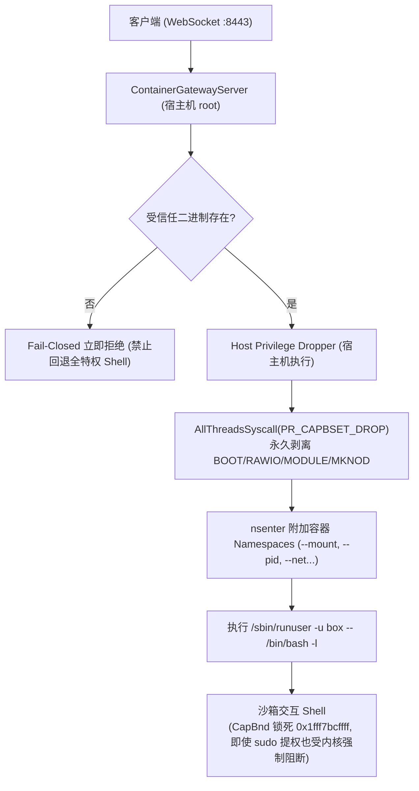

# AttackBox 系统架构规划书 (System Architecture Specification)

## 架构核心定位：纯分布式安全沙箱集群 (Distributed Security Sandbox Cluster)

AttackBox 是一套专为渗透测试人员、安全研究与技术教学打造的高性能分布式容器沙箱基础设施。系统全面采用 **“控制中心 (Control Hub) 与 牺牲品算力节点 (Sacrificial Worker Nodes)”** 的物理与逻辑彻底分离模型：

* **控制端 (Control Server)**: 部署于独立的受保护宿主机，作为系统集中管理大脑，负责 Web 控制台交付、用户认证、算力调度与机密管理。**Control 节点永远不运行任何不受信的沙箱容器，保持绝对安全。**
* **算力节点 (Worker Agent)**: 分布式部署于一组独立的云服务器或物理宿主机上，定位为**“可牺牲的纯算力耗材 (Sacrificial Compute)”**。Worker 节点本地零数据库、无管理控制监听端口、不存储任何系统机密，全面放行特权调试（ptrace）、剥离关机能力（Drop CAP_SYS_BOOT），严防宿主级逃逸以守护多租户底线隔离。被打崩或受污染时，通过底层云快照秒级回滚自愈。
* **极简原则 (YAGNI)**: 当前迭代严守精简边界，彻底剥离未规划的计费、邀请体系以及未上线的复杂靶机编排，聚焦于容器沙箱的高并发调度、内核特权防御与高吞吐交互。

---

## 目录索引 (Table of Contents)

* **第 1 章：系统分布式拓扑与 C/S 通信模型**
  * 1.1 分布式集群拓扑与节点角色定位
  * 1.2 牺牲品节点安全哲学 (Sacrificial Node Philosophy)
  * 1.3 双通道解耦机制 (反向长连接控制信道 vs 边缘直连数据信道)
* **第 2 章：Worker 沙箱核心运行时与特权放行规范**
  * 2.1 Btrfs 原生瞬态子卷快照与毫秒级派生机制
  * 2.2 Linux Namespaces 隔离、/proc/self/exe 自引导与 CLONE_INTO_CGROUP 机制
  * 2.3 物理资源配额与防 DoS 约束 (Cgroups v2 内存/进程/IO 限额与一次性初始化)
  * 2.4 沙箱特权放行与 P0-A 级逃逸防御规范 (宿主机可信特权剥离 / Bounding Set 全线程广播)
  * 2.5 销毁流水线状态保留与有界退出 (后删状态 / 5s 上下文超时)
* **第 3 章：双模交互引擎实现规范**
  * 3.1 PTY 远程命令行 (CLI) 桥接方案与自适应 Resize
  * 3.2 TigerVNC 远程桌面 (GUI) 按需加载与 Unix 套接字直通
* **第 4 章：沙箱单网桥网络隔离与槽位调度**
  * 4.1 虚拟专用网桥拓扑 (`br-attackbox`)
  * 4.2 沙箱二层端口隔离 (Bridge Port Isolation 防 ARP 欺骗与横向嗅探)
  * 4.3 WAN 出口白名单与控制面防回环规则
  * 4.4 批处理网络配置与 Fork 风暴消除
  * 4.5 SlotAllocator O(1) Free List 高性能槽位调度
* **第 5 章：Control 凭据认证、状态模型与安全追溯**
  * 5.1 数据持久化定位与 WAL 并发连接池 (16 并发读)
  * 5.2 基于 Ed25519 的客户端无状态 JWT 鉴权与 TokenVersion 内存高速缓存
  * 5.3 认证防时序侧信道、错误脱敏与 Admin 自动引导
  * 5.4 攻防沙箱安全责任追溯机制
* **第 6 章：分布式控制调度、数据流接入与会话生命周期**
  * 6.1 集中调度与管理员权威策略控制 (废除用户自定义策略 / 零配置 Fail-Closed)
  * 6.2 Ed25519 跨机能力凭证 (Ticket) 与 Worker 零 DB 离线验签
  * 6.3 交互会话并发控制与状态保活 (CLI/GUI 统一单活跃抢占机制)
  * 6.4 防 TOCTOU 并发双击预占与后台 Reaper 自动回收 (TTL & Idle)
  * 6.5 真实系统内核遥测采样 (/proc/meminfo 与 /proc/loadavg)
* **第 7 章：节点全生命周期管理、网络重连与传输层防护**
  * 7.1 节点生命周期状态机 (Online, Draining, Offline, Resetting)
  * 7.2 节点重连实例指针判等 (防旧连接退出误注销新节点)
  * 7.3 并发数据竞争防护 (ContainerGatewayServer 读写锁治理)
  * 7.4 传输层 DoS 拦截 (MaxHTTPPayloadSize 与 MaxWebSocketMessageSize)
  * 7.5 HTTP 生产级观测性、链路追踪与 Panic 恢复中间件
* **第 8 章：系统配置与凭据隔离**
  * 8.1 静态配置文件规范
  * 8.2 核心机密单向隔离与无状态 Worker

---

## 第 1 章：系统分布式拓扑与 C/S 通信模型

```
                               ┌────────────────────────────────┐
                               │       Control 管理中心节点       │
                               │  (独立物理机 / 云 VPS, 端口:443)  │
                               │                                │
                               │ • 独占全局持久化 SQLite (WAL)   │
                               │ • TokenVersion 内存高速缓存     │
                               │ • 静态金库: API Key / 签名私钥  │
                               │ • 集中算力调度与管理员策略下发   │
                               │ • 30s Reaper 会话生命周期回收   │
                               └───────────────┬────────────────┘
                                               ▲
                            跨公网 WSS 反向控制信道 (带保活与心跳)
                                               │
             ┌─────────────────────────────────┼─────────────────────────────────┐
             │                                 │                                 │
             │                                 │                                 │
             ▼                                 ▼                                 ▼
  ┌───────────────────────┐         ┌───────────────────────┐         ┌───────────────────────┐
  │   Worker 算力节点 1    │         │   Worker 算力节点 2    │         │   Worker 算力节点 N    │
  │   (Sacrificial Node)  │         │   (Sacrificial Node)  │         │   (Sacrificial Node)  │
  │                       │         │                       │         │                       │
  │ • 零 DB / 零用户数据   │         │ • 零 DB / 零用户数据   │         │ • 零 DB / 零用户数据   │
  │ • 仅开数据端口 :8443  │         │ • 仅开数据端口 :8443  │         │ • 仅开数据端口 :8443  │
  │ • Btrfs 原生子卷快照  │         │ • Btrfs 原生子卷快照  │         │ • Btrfs 原生子卷快照  │
  │ • 宿主机特权剥离执行器│         │ • 宿主机特权剥离执行器│         │ • 宿主机特权剥离执行器│
  │ • 纯内存离线验签Ticket│         │ • 纯内存离线验签Ticket│         │ • 纯内存离线验签Ticket│
  └───────────┬───────────┘         └───────────┬───────────┘         └───────────┬───────────┘
              ▲                                 ▲                                 ▲
              │                                 │ 浏览器直连 Worker 数据端口      │
              │                                 │ (不经 Control 中转, :8443)       │
              └─────────────────────────────────┼─────────────────────────────────┘
                                                │
                                      ┌─────────┴─────────┐
                                      │   用户浏览器终端   │
                                      │ (xterm.js / noVNC)│
                                      └───────────────────┘
```

### 1.1 分布式集群拓扑与节点角色定位
系统严格划分为两端：
* **Control 服务端 (Control Hub)**:
  * **角色定位**: 集中式有状态管理中心（Stateful Management Hub）。
  * **职责范围**:
    1. 独占 SQLite 数据库，全生命周期托管核心用户认证、令牌版本控制与操作审计日志。
    2. 维持全集群 Worker 反向连接池，统筹全局算力负载均衡与实例调度。
    3. 维护 `SessionManager` 与内存槽位分配器，执行原子预占防并发双击。
    4. 运行后台 Reaper，周期性扫描并回收硬超时（TTL）与长时间空闲（Idle）会话。
    5. 集中保管 Ed25519 签名私钥，分发跨机验签公钥与临时 Ticket。
* **Worker 客户端 (Worker Agent / Node)**:
  * **角色定位**: 分布式无状态牺牲品执行器（Stateless Managed Executor）。
  * **职责范围**:
    1. 100% 遵从 Control 下发的调度指令，负责本地 Btrfs 瞬态快照派生/销毁、单网桥隔离接入、Cgroups v2 配额限制与沙箱生命周期管理。
    2. 负责 PTY 伪终端主从对管理、TigerVNC 桌面按需拉起及本地 Unix Domain Socket 数据流桥接。
    3. 本地持有从 Control 同步的 Ed25519 公钥，进行纯内存极速离线验签，核销 JTI 防重放。
    4. 动态采集真实宿主机 `/proc/meminfo` 与 `/proc/loadavg` 指标并按期向控制中心上报。

### 1.2 牺牲品节点安全哲学 (Sacrificial Node Philosophy)
将算力节点定位为“牺牲品（Sacrificial Node）”是本架构的核心安全基石：
1. **物理隔离保护大脑**: Control 永远不与沙箱共处于同一台机器。即使沙箱被利用打穿至宿主机 root 甚至污染内核，受害范围被严格限制在该单一 Worker 物理机/虚拟机内，Control 的用户数据、数据库和系统机密毫发无损。
2. **出厂级瞬时恢复**: 一旦 Worker 被恶意篡改或测试损坏，管理员通过 Web 界面一键触发云底座 API 执行整机纯净快照回滚重建，秒级回归初始状态。

### 1.3 双通道解耦机制 (Control Channel vs Data Channel)
* **控制信道 (Control Channel - 反向长连接)**:
  * Worker 启动后作为客户端，主动通过 WebSocket (`wss://control.example.com/api/agent/connect`) 反向连接 Control 中心。
  * Worker 节点无需对外开放任何管理或 SSH 端口，天然免疫来自公网的直接扫描与暴破。
  * 承载流量：节点握手注册、周期心跳遥测、沙箱调度创建/销毁指令、安全策略下发。
* **数据信道 (Data Channel - 客户端直连 Worker 数据端口)**:
  * 各 Worker 仅开放单一公网端口 `:8443`。
  * 用户浏览器从 Control 取得合法的临时访问 Ticket 后，直接与沙箱所在的 Worker `:8443` 建立 WebSocket 直连，全程不经 Control 中转。
  * 海量高并发的 CLI 字符流与 VNC RFB 桌面图像流由客户端与 Worker 点对点传输，Control 节点的网络带宽绝不成为系统瓶颈。

---

## 第 2 章：Worker 沙箱核心运行时与特权放行规范

### 2.1 Btrfs 原生瞬态子卷快照与毫秒级派生机制
* **核心选型考量 (为什么坚持 btrfs 原生快照而拒绝 OverlayFS)**:
  1. **杜绝双重 CoW 损耗**: 在本身就是写时复制（CoW）的 btrfs 宿主上叠挂一层 OverlayFS 会导致双重 CoW 与双重元数据寻址，拖慢 I/O 吞吐并产生大量磁盘碎片。
  2. **100% 纯正 POSIX 语义与黑客工具兼容**: OverlayFS 存在跨层目录重命名报错 `EXDEV`、inode 动态变化等非标准 POSIX 行为；而 btrfs subvolume 快照在内核中是一个原生的标准根文件系统，GDB、Wireshark、Metasploit、Ghidra 等底层攻防工具零兼容报错。
  3. **零物理磁盘冗余**: 利用 btrfs 底层 extent 引用计数，直接秒级从母机只读模板快照克隆，创建耗时 `< 1ms`，物理磁盘占用为 0 字节。
* **实现原理与分层拓扑**:
  1. **只读基准脱敏金盘 (Golden Base - `base_rootfs`)**:
     Worker 启动时检查 `/var/lib/attackbox/base_rootfs`；若不存在，一次性从宿主机根目录 `/` 派生基准子卷，深度清洗宿主机敏感信息（清除 SSH 密钥、宿主账户、历史日志与凭据），并强制锁定为物理只读防篡改模板：
     ```bash
     btrfs property set /var/lib/attackbox/base_rootfs ro true
     ```
  2. **毫秒级可写瞬态子卷派生 (Transient Snapshot)**:
     调度器分配沙箱时，Worker 秒级从只读基准子卷派生独立的可写子卷：
     ```bash
     btrfs subvolume snapshot /var/lib/attackbox/base_rootfs /var/lib/attackbox/instances/<sandbox_id>/rootfs
     ```

### 2.2 Linux Namespaces 隔离、/proc/self/exe 自引导与 CLONE_INTO_CGROUP 机制
沙箱启动时强制启用核心命名空间：
* `CLONE_NEWPID`: 进程隔离，沙箱内无法观测宿主机进程，内部首进程 PID 为 1。
* `CLONE_NEWNS`: 挂载点隔离，通过 `pivot_root` 彻底将实例 rootfs 替换为根目录，隔离宿主文件系统。
* `CLONE_NEWUTS`: 隔离主机名，沙箱内拥有独立的主机标识。
* `CLONE_NEWIPC`: 隔离 IPC 消息队列与共享内存。
* `CLONE_NEWNET`: 隔离网络命名空间。
* **原生 CLONE_INTO_CGROUP 特性**:
  通过 Linux 5.7+ 原生系统调用标志，在子进程诞生的首个时钟周期即原子放入目标 Cgroup，彻底消除传统“先 fork 再写 cgroup.procs”带来的微秒级 Fork 炸弹逃逸窗口。

### 2.3 物理资源配额与防 DoS 约束
* **Cgroups v2 严格 Fail-Closed 保底**:
  - `memory.max`: 管理员下发或默认保底为 2048MB（严禁写入 `max` 导致无限滥用）。
  - `memory.swap.max`: 强制锁定为 0，杜绝 Swap 抖动击穿宿主磁盘。
  - `pids.max`: 默认保底为 512，防范 Fork 炸弹。
  - `cpu.weight`: 默认设置为 100，实行 CPU 调度公平分享。
* **Cgroup 一次性初始化优化 (`sync.Once`)**:
  `EnsureParentHierarchy` 通过 `sync.Once` 保护，确保 `/sys/fs/cgroup/cgroup.subtree_control` 与 `$CgroupRoot/cgroup.subtree_control` 仅在节点生命周期内写入一次，避免每次建箱重复重写系统控制文件。
* **宿主机全局磁盘水位熔断 (Disk Guard)**:
  Worker 后台协程周期性监控物理存储空间。当空闲容量跌破安全阈值时，自动熔断拒绝新建沙箱，杜绝宿主机磁盘触发 `ENOSPC` 故障。

### 2.4 沙箱特权放行与 P0-A 级逃逸防御规范
针对租户在沙箱内拥有 `sudo` 权限的攻防场景，系统确立了**“宿主机可信特权剥离”**与**“Fail-Closed 阻断机制”**：



1. **宿主机端特权剥离执行**:
   网关启动交互 PTY 时，特权剥离逻辑由宿主机受信任入口负责（`/usr/local/bin/attackbox-enter` 或宿主运行中的单二进制 `__enter__`），**绝不调用沙箱内部可写快照中的任何可执行文件**。
2. **Fail-Closed 绝不回退**:
   若宿主机特权剥离程序无法解析，网关直接拒绝建立连接，**严禁回退执行无特权限制的 root 终端 Shell**。
3. **Bounding Set 全线程原子广播**:
   使用 `syscall.AllThreadsSyscall(unix.PR_CAPBSET_DROP, ...)`，确保 Go 运行时的所有物理 OS 线程同步剥离 `CAP_SYS_BOOT`、`CAP_SYS_RAWIO`、`CAP_SYS_MODULE`、`CAP_MKNOD`。即使租户在容器内通过 `sudo` 提权至 root，内核仍强制返回 `EPERM`。
4. **沙箱镜像纯净无注入**:
   彻底清除金盘构建阶段对沙箱内 `/usr/bin/attackbox-enter` 的文件注入逻辑，沙箱内部无需驻留任何定制特权剥离工具。

### 2.5 销毁流水线状态保留与有界退出
为避免销毁阶段因 D 状态进程挂死或部分资源失败导致孤儿泄漏，系统严格实行**“后删状态”与“有界等待”**：
1. **进程有界等待**: 调用 `cmd.Wait()` 时配置 5s Context 超时保护，超时后向进程组强制发送 `SIGKILL`，杜绝销毁协程无限挂起。
2. **挂载点安全卸载**: 调用 `mountpoint -q` 检查并执行 `umount -l`，聚合记录挂载清理结果。
3. **微秒级销毁退避**: 在 `cgroup_v2_controller.Destroy` 中引入 `isCgroupEmpty`，优先检测 `cgroup.events`（`populated 0`），配合 2ms 指数退避，消除了每 50ms 读文件的粗暴轮询。
4. **后删状态原则**: 只有在进程、挂载点、Cgroup、Btrfs 快照全部确认清理完毕后，才从内存中注销沙箱记录并释放 IP 槽位。若清理失败，保留内存状态供后续重试，杜绝资源泄漏。

---

## 第 3 章：双模交互引擎实现规范

### 3.1 PTY 远程命令行 (CLI) 桥接方案与自适应 Resize
* **实现基石**: 基于 Linux 原生伪终端（PTY）主从设备机制（`/dev/ptmx` 与 `/dev/pts/*`）。
* **进程进入与数据桥接流水线**:
  1. Worker 接收到建立 CLI 终端连接的 WebSocket 握手并验证 Ticket。
  2. Worker 打开宿主 PTY 主从对 (`ptmx, pts`)。
  3. 执行受信任特权剥离执行器附加至目标沙箱命名空间，并将 PTS 重定向为 Shell 的输入输出。
  4. 将启动的进程 PID 绑定至该沙箱的 Cgroup。
  5. 协程监听 `ptmx` 输出并以 WebSocket 二进制帧推流给前端；同时将用户击键字符流写入 `ptmx`。
* **窗口动态自适应 (Resize)**:
  前端 xterm.js 窗口缩放时投递 JSON 控制帧，Worker 解析后调用底层 `pty.Setsize` 触发 `SIGWINCH` 信号，使终端布局自适应。

### 3.2 TigerVNC 远程桌面 (GUI) 按需加载与 Unix 套接字直通
* **按需拉起**: 用户仅打开 CLI 终端时绝不启动图形进程；点击“打开桌面”时按需触发 `EnsureGUI(sandbox_id)`。
* **Unix Domain Socket 直通**:
  TigerVNC 服务强制仅监听本地 Unix Domain Socket（如 `/run/attackbox/<sandbox_id>/gui.sock`），对外不开放任何 TCP 端口，全双工桥接用户 WebSocket 数据流。

---

## 第 4 章：沙箱单网桥网络隔离与槽位调度

### 4.1 虚拟专用网桥拓扑 (`br-attackbox`)
Worker 节点内部构建单一私有虚拟网桥：
* **网段规划**: `10.200.0.0/16`，宿主网关：`10.200.0.1`。
* **虚拟网卡对**: 每个沙箱分配一对 `veth`（宿主端 `vh<slot>`，沙箱端 `eth0`），沙箱 IP 按槽位确定为 `10.200.0.<10+slot>/16`。

### 4.2 沙箱二层端口隔离 (Bridge Port Isolation)
* **二层端口隔离标志**: 宿主端虚拟网卡挂载到网桥时，强制开启端口隔离：
  ```bash
  ip link set vh<slot> type bridge_slave isolated on
  ```
  内核强制拦截所有标记为 `isolated on` 端口之间的二层通信（ARP 广播、单播等），彻底免疫沙箱间的 ARP 欺骗与横向嗅探。

### 4.3 WAN 出口白名单与控制面防回环规则
* **外网严格放行核心端口**: nftables 仅放行 DNS (`UDP 53`)、HTTP (`TCP 80`)、HTTPS (`TCP 443`)，其余外网流量全数丢弃。
* **阻断控制面与内部回环**: 严格阻断沙箱访问 Worker 本地回环（`127.0.0.1/8`）及向 Control 控制信道端口发起探测。

### 4.4 批处理网络配置与 Fork 风暴消除
沙箱内部网络配置（网卡重命名为 `eth0`、分配 IP、启动网卡、启用 Loopback 及配置默认网关）由单次原子 Shell 脚本批处理调用完成，将外部进程派生次数从原本的 10 余次收敛至极简，消除频繁 fork 对内核调度造成的冲击。

### 4.5 SlotAllocator O(1) Free List 高性能槽位调度
在 Control 节点中，网络槽位分配器采用常数时间算法：
* **数据结构**: `freeList []int` + `slotToID map[int]string` + `idToSlot map[string]int`。
* **分配**: O(1) 从 `freeList` 头部弹出最小可用槽位，优先复用低位 IP。
* **释放**: O(1) 反查映射表完成注销，并将槽位按序插回 `freeList`。

---

## 第 5 章：Control 凭据认证、状态模型与安全追溯

### 5.1 数据持久化定位与 WAL 并发连接池 (16 并发读)
Control 节点独占 SQLite 数据库（`attackbox.db`），强制启用 WAL 模式并发优化：
```
sqlite3://attackbox.db?_journal_mode=WAL&_busy_timeout=5000
```
连接池配置放宽至 `SetMaxOpenConns(16)` 与 `SetMaxIdleConns(8)`，允许多个只读请求并发穿透，彻底消除单连接瓶颈。

### 5.2 基于 Ed25519 的客户端无状态 JWT 鉴权与 TokenVersion 内存高速缓存
* **JWT 签名**: 采用 Ed25519 纯内存签名，有效载荷包含 `sub`、`username`、`role`、`ver`、`exp`。
* **TokenVersion 高速缓存**: 引入基于 `sync.RWMutex` 的 `TokenVersionCache`（10s TTL）。高频鉴权请求直接命中内存校验，实测 50 并发请求在 29.7ms 内完成（单次验证延迟约 200µs），系统吞吐可达数千 QPS。

### 5.3 认证防时序侧信道、错误脱敏与 Admin 自动引导
1. **时序侧信道消除**: 用户登录验证时，无论用户名是否存在，均无条件执行一次耗时恒定（~83ms）的 Dummy Bcrypt 比较运算，抹平用户名枚举攻击面。
2. **报错脱敏**: 数据库主键与唯一索引冲突等底层错误拦截脱敏为统一文本（`username or email already registered`），严防内部表结构泄露。
3. **Admin 引导闭环**: 支持通过配置文件预设初始管理员，并在首位用户注册时自动提权至 `role='admin'`，确立系统管理权限的自然闭环。

### 5.4 攻防沙箱安全责任追溯机制
1. **统一标识与审计**: 用户分配全局唯一 `uid`，沙箱分配 `sandbox_id`，关键生命周期流转记录入 `audit_logs` 表。
2. **操作责任闭环**: 针对登录鉴权、沙箱派发与终止、违规访问拦截等关键事件持久化存储，满足合规审查需要。

---

## 第 6 章：分布式控制调度、数据流接入与会话生命周期

### 6.1 集中调度与管理员权威策略控制
* **废除用户传参策略**: `StartSandboxReq` 变更为纯空结构体 `{}`，普通租户绝对禁止自定义内存与 CPU 策略。
* **管理员权威配置**: 沙箱物理限制严格遵循 Control 配置文件由管理员统一制定，通过 RPC 指令权威下发至 Worker 节点。
* **Fail-Closed 兜底**: 若配置参数缺失或出现零值，控制端与底层驱动严格采用安全兜底限制（2048MB 内存、512 进程），绝不生成无限制沙箱。

### 6.2 Ed25519 跨机能力凭证 (Ticket) 与 Worker 零 DB 离线验签
* **Ticket 载荷**: 包含 `jti`、`sub`、`sbx`、`typ`、`exp`（60秒内有效）。
* **纯内存离线验签**: Worker 使用预置的 Ed25519 公钥本地完成数学验签（耗时 `< 0.1ms`），并通过 JTI 过滤器防止重放攻击。

### 6.3 交互会话并发控制与状态保活
针对同一沙箱的 PTY 或 VNC 连接，Worker 维护单活跃会话表。若新连接接入，主动向旧连接发送 `4001 Preempted` 控制帧优雅关闭旧通道，确保单终端输入的时序一致性。

### 6.4 防 TOCTOU 并发双击预占与后台 Reaper 自动回收
* **原子预占 (`TryReserve`)**: `SessionManager` 在收到创建请求时立即实施基于用户 ID 的内存原子锁，快速并发双击请求首发返回 `201 Created`，次发精准返回 `409 Conflict`，杜绝旧沙箱失控漂移。
* **后台自动 Reaper**: 控制端运行 30s 周期性扫描协程，自动清理硬超时（TTL）及长时间未活动的空闲（Idle）沙箱。
* **单路径终止流水线**: 手动停止与后台回收统一流经 `TerminateSandbox`，保证流程无分叉。

### 6.5 真实系统内核遥测采样
Worker 节点通过读取 `/proc/meminfo`（`MemTotal` 与 `MemAvailable`）和 `/proc/loadavg` 获取微秒级真实的物理系统指标，向 Control 心跳上报诚实数据，彻底废除一切伪造标记与硬编码数值。

---

## 第 7 章：节点全生命周期管理、网络重连与传输层防护

### 7.1 节点生命周期状态机
* `Online`: 节点心跳正常（每 3 秒），处于正常调度池。
* `Draining`: 节点处于排空维护期，仅运行存量，不接受新分配。
* `Offline`: 连续 10 秒无心跳，自动剔除出调度队列。
* `Resetting`: 节点正在执行底层云快照回滚重建。

### 7.2 节点重连实例指针判等
`node_cluster_manager.go` 中的 `unregisterWorker` 严格采用实例指针判等：
```go
if h.workers[w.NodeID] == w {
    delete(h.workers, w.NodeID)
}
```
当节点快速断线重连建立新连接时，旧连接退出触发的清理逻辑绝不会误删已登记的新连接，保障调度器始终持有有效路由。

### 7.3 并发数据竞争防护
在 [`node/container_gateway_server.go`](file:///F:/deepseek/attackbox/node/container_gateway_server.go) 中，网关持有的 Ed25519 公钥通过 `keyMu sync.RWMutex` 进行读写保护，`SetPublicKey` 上写锁，客户端交互端上读锁，经受 `go test -race` 高并发压测保证零报警。

### 7.4 传输层 DoS 拦截
* **HTTP Body 限制**: 全局应用 `http.MaxBytesReader` 限制 1MB（`protocol.MaxHTTPPayloadSize`），超大报文精准拦截并返回 `HTTP 413 StatusRequestEntityTooLarge`。
* **WebSocket 帧限制**: 控制面设置 `SetReadLimit(1MB)`，数据面 PTY 设置 `SetReadLimit(64KB)`，超大恶意数据帧触发底层强制断开连接。

### 7.5 HTTP 生产级观测性、链路追踪与 Panic 恢复中间件
* **状态码拦截**: 实现 `statusResponseWriter` 拦截并记录 HTTP 响应状态码，同时原生实现 `http.Hijacker` 与 `http.Flusher`，保障 WebSocket 升级协议顺畅穿透。
* **全链路请求 ID**: 自动生成或透传 `X-Request-ID`，注入请求 Context 与响应头。
* **全局 Panic 恢复**: `recoveryMiddleware` 拦截意外 panic，打印堆栈并输出标准 500 JSON 错误。
* **统一日志格式**: 废除分散的 `fmt.Printf`，全量统一为标准库 `log.Printf`。

---

## 第 8 章：系统配置与凭据隔离

### 8.1 静态配置文件规范
* **Control 配置文件 (`configs/control.yaml`)**:
  * 静态包含：Web 监听端口、TLS 证书配置、Ed25519 签名私钥、集群通信密钥 `cluster_secret`、SQLite 数据库路径及初始 Admin 账号密码。
* **Worker 配置文件 (`configs/worker.yaml`)**:
  * 静态包含：数据端口监听（`:8443`）、TLS 证书、Control 反向连接地址（`wss://...`）、Ed25519 验签公钥、集群密钥 `cluster_secret` 与本节点标识 `node_id`。

### 8.2 核心机密单向隔离与无状态 Worker
* **私钥留底，公钥下发**: Control 独占持有签名私钥，Worker 仅持有公钥用于离线验签。Worker 即使遭到逆向或内存 Dump，也绝无法伪造合法的系统访问 Ticket。
* **Worker 物理零机密、零数据库**: Worker 本地无持久化数据库，受害面严格锁死在该牺牲品节点内部，保障中心控制资产绝对安全。
