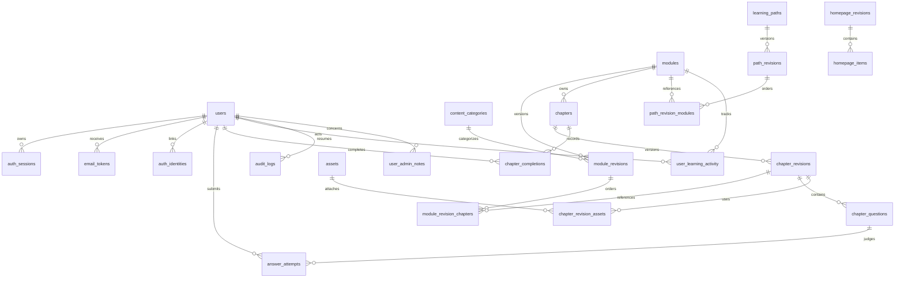

# AttackBox 学习平台数据库设计 v1

日期：2026-10-23。状态：设计稿；产品规则已确认，表结构待按本文实现为 Drizzle schema 和迁移。

## 1. 已确认的边界

1. 新平台重新注册，不迁移 Go Control 的账号、密码、Session 或用户 ID。
2. 模块介绍、路线介绍、已发布目录公开。章节分别设置 `public` 或 `authenticated`。
3. 公开章节可直接阅读，不受进度锁限制；其他章节登录后按顺序解锁。
4. 每章可以有多个输入答案题，全部答对才完成，允许重复作答。
5. 教程更新不撤销已完成章节，不自动要求重做。
6. 模块包含章节；路线是多个现有模块的有序集合，不复制模块正文。
7. 管理员维护内容，支持 Markdown 编辑／上传；GitHub 导入作为可选输入方式。
8. 第一版不做会员、付费、论坛、复杂角色矩阵；本次不设计 Worker 调度、沙箱实例与使用计费表。

以下是为形成完整闭环采用的第一版规则：无测验章节通过显式“标记完成”完成；草稿在模块级保存和发布；不限制路线内模块的学习先后，只有模块内章节顺序解锁。这些规则与会员或沙箱无关，后续可独立调整。

## 2. 技术和职责

- PostgreSQL 17，Drizzle ORM，Nuxt Nitro 服务端业务接口。
- 业务主键用 UUID，应用生成；不要复用旧系统的自增 ID。排序用正整数。
- 时间使用 `timestamptz`，数据库与接口按 UTC 存取，界面按用户时区展示。
- 核心关系使用外键；JSONB 只保存非核心审计上下文，不把课程、章节和进度塞入一个大 JSON。
- 网站账号与内容由 Nuxt 服务维护。Go 未来作为环境服务接入新平台用户 ID；在实现显式身份桥接前，两套登录状态互不认可。
- 本次不改 Go SQLite、不连接生产数据库、不自动执行建表。Drizzle 迁移应在实现阶段单独生成和评审。

`web` 当前是页面阶段：认证仍为模拟交互，没有 `server/` 和数据库层。`scripts/deploy_web_phase1.ps1` 仅部署 `nuxt generate` 静态产物。接入本设计后需部署 Node/Nitro 服务；公开首页仍可预渲染。

## 3. 关系总览

模块、章节、路线的 ID 是长期身份；revision 是某次内容版本。进度依赖长期身份，判题依据具体版本。读者只看到当前发布指针指向的版本，管理员编辑草稿不会影响它。

以下字段中 `?` 表示允许 NULL。外键删除策略默认 `RESTRICT`；只在明确说明的临时／附属数据上使用 `CASCADE`。

## 4. 账号与身份

### users

| 字段 | 类型 | 说明 |
| --- | --- | --- |
| id | uuid PK | 新平台身份 |
| email | varchar(254) | trim 后转小写；唯一，不允许空白 |
| display_name | varchar(64) | 展示名，可重复，不作为登录依据 |
| password_hash | text? | Argon2id 哈希；纯第三方账号可为空 |
| role | varchar(16) | `user` / `admin`，默认 user |
| status | varchar(16) | `pending` / `active` / `suspended` |
| email_verified_at | timestamptz? | 邮箱验证时间 |
| created_at / updated_at | timestamptz | 创建、修改时间 |
| last_login_at | timestamptz? | 最近一次真实登录 |

约束：`email = lower(btrim(email))`，邮箱 UNIQUE，角色与状态 CHECK，展示名 trim 后非空。状态变为 active 前必须通过邮箱验证或完成可信提供方的验证流程。数据库邮箱检查只保证基本结构，完整格式检查在服务端完成。

不新增会员字段，不把用户角色和会员等级混为一谈。封禁不删除学习记录。第一位管理员通过受控初始化命令创建，注册接口永远不能接受 role/status 参数。

### auth_sessions

`id uuid PK`、`user_id FK users`、`token_hash bytea UNIQUE`、`created_at`、`expires_at`、`last_seen_at`、`revoked_at?`、`ip inet?`、`user_agent varchar(512)?`。

Session 为高熵不透明随机串；数据库仅存 SHA-256 摘要（32 字节）。Cookie 使用 HttpOnly、Secure、SameSite=Lax；“保持登录”只影响有效期，不能把密码或长期 bearer token 存入 localStorage。第一版建议常规会话 24 小时、保持登录 30 天，绝对有效期，不默认无限滑动续期。每次授权检查会话未过期、未撤销且用户 active。修改密码、封禁、角色变更撤销相关 Session。管理员不能取消最后一个正常管理员的权限，相关操作需事务加锁。

索引：`token_hash` 唯一；`(user_id, expires_at)`；`expires_at` 用于清理。`expires_at > created_at`。账号物理清理时可 CASCADE 清理会话。

### email_tokens

`id uuid PK`、`user_id FK users`、`target_email varchar(254)`、`purpose`（`verify_email` / `reset_password`）、`token_hash bytea UNIQUE`、`created_at`、`expires_at`、`consumed_at?`。

邮箱验证有效期建议 24 小时、密码重置 30 分钟。一次性随机凭证只存摘要；检查有效期、用途、目标邮箱仍匹配、未消费。验证或重置和消费凭证在同一事务内，防止重复使用。密码重置不改变账户封禁状态。非现存账号的找回请求返回同样的外部提示，不伪造数据库账号。邮件发送失败不能标记为已验证。

### auth_identities（启用第三方登录时建）

`id uuid PK`、`user_id FK users`、`provider_key varchar(80)`、`issuer text`、`subject text`、`created_at`、`last_login_at?`。

唯一 `(issuer, subject)`；账号关联不能仅凭相同邮箱自动完成。绑定新身份要求已登录确认，或明确验证两个身份的所有权。GitHub 使用稳定数字用户 ID 作为 subject；OIDC 使用经验证的 issuer/sub。第一版若不启用第三方登录，可延后建表，隐藏未启用入口；不存提供方 access token，除非业务确有调用需求。

## 5. 图片与附件

### assets

`id uuid PK`、`storage_key text UNIQUE`、`original_name varchar(255)`、`media_type varchar(120)`、`byte_size bigint`、`sha256 bytea`、`visibility`（`public` / `private`）、`uploaded_by FK users`、`created_at`、`archived_at?`。

文件放 VPS 文件目录或对象存储，数据库存索引，不把二进制塞入正文。storage_key 指向不可覆盖的文件，替换图片要新建 asset，不能原地替换已发布文件。`byte_size >= 0`，摘要为 32 字节。去重须考虑访问域，不因公共同名或相同摘要就授予私有附件访问权。

模块封面只能引用 public 资源。受限正文图片使用 private 资源，通过章节授权接口读取；签名链接若使用则短时有效。公开附件是明确的公开发布，不能只给 Markdown 接口鉴权而把受限附件放在公开目录。

### chapter_revision_assets

`chapter_revision_id FK chapter_revisions`、`asset_id FK assets`，联合主键。绑定在保存修订时从正文引用中解析，参与发布快照。资源授权基于当前已发布且调用者可读的章节关联；旧修订或管理员预览链接不能成为绕过入口。已被发布快照引用的资源不可直接删除。

## 6. 模块与章节

### modules：模块的稳定身份

`id uuid PK`、`slug varchar(100) UNIQUE`、`published_revision_id uuid?`、`created_by FK users`、`created_at`、`archived_at?`。

slug 用小写字母、数字和短横线，首次发布后固定；需要改地址时未来增加重定向表。未发布模块对普通用户不可见，标题等展示字段不放在此表，防止草稿泄漏。

### content_categories：内容归类（已补充）

`id uuid PK`、`slug varchar(100) UNIQUE`、`name varchar(80) UNIQUE`、`position integer`。

例如 Web 安全、Linux 基础、云原生安全；与难度独立。第一版每个模块版本一个主分类，可为空表示未分类；公开列表读取当前发布版本分类，后台可新建分类。实际迁移与修复说明见 [生命周期修复](content-lifecycle-repairs.md)。

### module_revisions：模块草稿与发布记录

`id uuid PK`、`module_id FK modules`、`revision_no integer`、`state`（`draft` / `published`）、`title varchar(160)`、`summary varchar(500)`、`description_markdown text`、`cover_asset_id FK assets?`、`category_id FK content_categories?`、`difficulty`（`beginner` / `intermediate` / `advanced`）、`lock_version integer`、`created_by FK users`、`created_at`、`updated_at`、`published_at?`。

- 唯一 `(module_id, revision_no)`；每模块至多一个 draft，使用部分唯一索引。
- `published_revision_id` 必须指向同模块的 published 修订。复合外键保证归属，状态由发布事务检查。
- draft 可改；published 不可改。发布后再次编辑，建立新的 draft。
- `lock_version` 实现编辑并发检查；保存时携带版本，冲突返回 409，不静默覆盖另一位管理员的修改。
- 草稿标题可暂缺，但发布必须通过完整校验；页面新建后能立即保存未完成内容。

### chapters：章节的稳定身份

`id uuid PK`、`module_id FK modules`、`slug varchar(100)`、`created_at`、`archived_at?`。

唯一 `(module_id, slug)`；一个章节只属于一个模块。删除章节等价于从下一发布版本中移除，不物理删除已经关联学习记录的章节。

### chapter_revisions：正文快照

`id uuid PK`、`chapter_id FK chapters`、`title varchar(160)`、`access`（`public` / `authenticated`）、`body_markdown text`、`source_kind`（`editor` / `upload` / `github`）、`source_url text?`、`source_commit varchar(64)?`、`source_sha256 bytea?`、`is_sealed boolean`、`created_by FK users`、`created_at`。

正文以数据库中的 Markdown 快照为发布依据。外部链接仅作为来源；导入、上传和网页编辑最终保存同一数据结构。GitHub 文件变化不会静默改动已发布正文，需再次导入、预览、发布。没有独立“内容源中心”或每次阅读实时抓 GitHub 的依赖。

一次保存创建新的 chapter_revision，写入题目和附件引用，事务末尾 `is_sealed=true`。封存后正文、题目、附件关联都不可改，后续编辑新建修订。未改动章节直接复用已有封存修订，避免无意义复制正文。未封存修订不允许出现在发布版本中。

Markdown 源文可保存用户编辑的文本，但渲染必须禁用／清洗危险 HTML 与 URL；导入服务限制大小、超时和目标地址，防止 SSRF。私库凭证不写进 source_url 或正文。受限内容不进入公开 Git、静态产物或首页接口。

### module_revision_chapters：某个模块版本的章节清单

`module_revision_id FK module_revisions`、`chapter_id FK chapters`、`chapter_revision_id FK chapter_revisions`、`position integer`。

主键 `(module_revision_id, chapter_id)`；唯一 `(module_revision_id, position)`；`position > 0`。保存时允许延迟检查排序唯一性，以便事务内交换位置。

必须保证模块修订、章节及章节修订同属一个 module；Drizzle 迁移用复合唯一键和复合外键实现，不能只验证三个 ID 分别存在。章节顺序属于模块版本，不放在 chapters 稳定身份表，避免草稿排序改变线上目录。

## 7. 输入答案测验

### chapter_questions

`id uuid PK`、`chapter_revision_id FK chapter_revisions`、`question_key uuid`、`position integer`、`prompt_markdown text`、`error_hint text?`、`normalization`（`exact` / `trim` / `trim_casefold`）、`answer_hmac bytea?`、`answer_key_version smallint`。

- 唯一 `(chapter_revision_id, position)` 和 `(chapter_revision_id, question_key)`；position > 0。
- `question_key` 表示编辑过程中的题目身份；新章节修订中可沿用 key，但题目行 id 随版本新建，提交必须针对当前发布版本。
- 第一版每题一个标准答案，所有题均必答；不引入题库、评分权重、正则判题、脚本执行。
- 默认 trim，只去掉首尾空白，不能默认忽略大小写；需要忽略大小写的题显式设置规则。
- 草稿允许题目提示和答案暂缺；answer_hmac 为 NULL 表示尚未设置，非 NULL 时必须为 32 字节。发布校验要求题目与答案齐全，判题永不处理未发布的缺失答案题。
- 保存 `HMAC-SHA256(服务端答案密钥, 规范化答案)`，不存低熵答案的裸 SHA-256。密钥只在服务端保管，用 answer_key_version 标识。比较使用常量时间函数。
- HMAC 不可逆，后台显示“已设置答案”，不是返回原答案；修改题目时显式替换答案。答案密钥轮换保留旧 key 直至旧题目重新设置答案，不能假设可从摘要重算新摘要。
- 普通读者接口明确白名单序列化题目，不返回 answer_hmac、密钥版本或 source 私有信息。管理员预览也不需要返回答案摘要。

### answer_attempts

`id uuid PK`、`user_id FK users`、`question_id FK chapter_questions`、`module_revision_id FK module_revisions`、`idempotency_key uuid`、`request_hmac bytea`、`request_key_version smallint`、`is_correct boolean`、`created_at`。

唯一 `(user_id, idempotency_key)`；索引 `(user_id, question_id, is_correct)`、`created_at`。不存用户输入原文，不把它写入日志。request_hmac 使用独立用途的服务端密钥并记录 request_key_version，轮换时保留有效幂等记录所需旧密钥。idempotency_key 只去重同一次提交，新的作答必须用新 key；重复请求返回原结果，换题或换请求内容复用 key 返回冲突，用 request_hmac 保存题目、模块版本和输入的服务端 HMAC 以识别，不能只按 key 返回另一道题结果。

提交事务检查 question 属于当次当前发布 module_revision 的章节清单，防止跨模块／旧草稿判题。正确题不会因之后答错而失效；同章各题可分多次通过，不要求同一请求全部正确。接口限流与最小提交间隔限制暴力猜答案，但第一版不设永久尝试上限。

未完成章节的部分正确记录只在相同 chapter_revision 中生效；正文或测验产生新章节修订后，旧部分答题仍可审计但不自动拼到新版本。未修改章节复用修订，部分进度不受影响。

## 8. 完成记录与学习进度

### chapter_completions

`user_id FK users`、`chapter_id FK chapters`、`completed_chapter_revision_id FK chapter_revisions`、`completed_module_revision_id FK module_revisions`、`method`（`quiz` / `manual_mark`）、`completed_at`。

主键 `(user_id, chapter_id)`，索引 `(chapter_id, completed_at)`。复合外键确保完成时所记录的章节修订确实位于对应模块版本清单中。

第一次完成后保留，不因发布新正文、改题、下架再上线或暂停账号而删除。界面可说明“已完成，内容有更新”，不强迫重做。管理员不能通过普通用户管理表单任意篡改此表。

模块完成度以当前已发布清单为分母，按稳定 chapter_id 与完成记录求交集计算；不重复保存易失真的 `completed_count`。添加新章可能让模块从 100% 变为未全部完成，但已有章节不会退回未完成。移除章节不再计入当前分母，历史记录仍保留。

### user_learning_activity

`user_id FK users`、`module_id FK modules`、`last_chapter_id FK chapters?`、`started_at`、`last_viewed_at`，联合主键 `(user_id, module_id)`。

用于“继续学习”和最近学习列表，不作为测验通过证据。复合外键保证 last_chapter_id 属于该 module；章节若在新版移除，继续入口回退到当前第一个未完成章节。访客不建此表；匿名阅读不偷偷创建虚拟用户。

统计可先由完成、答题和最近学习记录计算。页面停留时间不等于学习时长，不据此虚构时长或用户画像。真实活跃时长和沙箱使用数据在接入事件采集后另行设计。

### 权限与顺序判定

1. 先要求模块当前已发布、未归档，且目标章节在当前清单内。
2. `public` 章节直接可读，访客也可访问，无进度前置要求。
3. `authenticated` 章节要求 active 用户有效登录；该章已完成，或所有前置章节均完成，才可读。
4. 目录始终展示发布版本的标题和锁定状态，不能因可见目录就返回受限正文。
5. 公开章节可跳读不等于已完成；登录后仍需答题或标记完成，才能作为后续章节的前置通过。
6. 第一章没有前置章节。跨模块不设自动依赖，路线中的模块顺序是建议学习顺序。
7. 无测验章节使用显式完成接口；有题章节不能绕过判题调用“标记完成”。

同一个权限函数必须用于正文、测验提交和私有附件。已完成也不能绕过模块下架／账号封禁；完成记录仅豁免顺序要求。

## 9. 学习路线

### learning_paths

`id uuid PK`、`slug varchar(100) UNIQUE`、`published_revision_id uuid?`、`created_by FK users`、`created_at`、`archived_at?`。

### path_revisions

`id uuid PK`、`path_id FK learning_paths`、`revision_no integer`、`state`（draft / published）、`title varchar(160)`、`summary varchar(500)`、`cover_asset_id FK assets?`、`lock_version integer`、`created_by FK users`、`created_at`、`updated_at`、`published_at?`。

与模块相同：每路线一个 draft，历史 published 不可变，发布指针限定同一路线。路线介绍和目录公开。

### path_revision_modules

`path_revision_id FK path_revisions`、`module_id FK modules`、`position integer`。主键 `(path_revision_id, module_id)`；唯一 `(path_revision_id, position)`，position > 0。

引用 module 的稳定 ID，阅读时使用模块当前发布版本，不把模块正文复制进路线，也不固定为旧模块版本。发布路线检查所有引用模块可用。

与管理原型一致：下架模块时，在同一事务中下架引用它的已发布路线；保留路线和模块的历史修订，不物理删除。并发路线发布／模块下架要锁住相关模块并重新检查。

路线完成度由当前路线模块集合及各模块当前章节完成度推导，不另设一份路线完成记录。

## 10. 首页内容管理

### homepage_revisions

`id uuid PK`、`revision_no integer UNIQUE`、`state`（draft / published）、`is_current boolean`、`lock_version integer`、`created_by FK users`、`created_at`、`updated_at`、`published_at?`。

部分唯一索引保证最多一个 draft、最多一个 is_current=true；CHECK current 必须 published。更换当前版本在事务中先取消旧 current 再设置新 current，外部读者只见提交前后完整状态。

### homepage_items

`id uuid PK`、`homepage_revision_id FK homepage_revisions`、`slot`（`featured` / `module_rail`）、`position integer`、`module_id FK modules?`、`path_id FK learning_paths?`、`headline_override varchar(160)?`、`summary_override varchar(500)?`、`image_asset_id FK assets?`、`enabled boolean`。

CHECK module_id/path_id 恰好一项有值；`module_rail` 只能引用 module。唯一 `(homepage_revision_id, slot, position)`；featured 每个 revision 至多一项。发布校验 enabled 项目标当前已发布、图片公开。标题封面未覆盖时取目标当前发布资料，不复制整份课程。

本版首页只有大幅精选和模块架，不新增广告系统或自由 URL 跳转。目标下架后首页接口立即过滤不可用项，主精选可回退到第一条可用模块；没有可用内容时不渲染该区，禁止继续链接到下架正文。

## 11. 后台管理与审计

### audit_logs

`id uuid PK`、`actor_user_id FK users?`、`action varchar(80)`、`target_type varchar(40)`、`target_id uuid?`、`metadata jsonb`、`request_id uuid?`、`ip inet?`、`created_at`。

记录发布／下架、封禁／恢复、角色修改和配置变更。metadata 是受控字段白名单，不保存密码、Cookie、答案、重置 token 或服务密钥。多态 target_id 仅作审计标识，不承担业务外键完整性；记录不会因目标归档而丢失。

索引 `(target_type, target_id, created_at DESC)`、`(actor_user_id, created_at DESC)`。审计记录只追加；关键管理操作与日志同事务提交。

### user_admin_notes

`id uuid PK`、`subject_user_id FK users`、`author_user_id FK users`、`body text`、`created_at`、`updated_at`。索引 `(subject_user_id, created_at DESC)`。仅管理员访问，不进入用户资料 DTO 或公开画像。

后台用户画像、兴趣标签、邮件／OIDC／Turnstile 接入配置在后续小阶段单独补表。凭证不应提前塞入 users 或任意 JSONB；接入时采用独立配置表、加密秘密字段与服务端密钥管理，不在本轮学习核心表中扩张。

## 12. 数据完整性与索引实施清单

- 所有用户外键指向新平台 users；没有 legacy_user_id 和账号迁移映射表。
- 版本归属使用复合 FK；进度证据与发布清单一致，不能只靠接口传入 module_id。
- FK 常用反向查询补索引：`chapter_revisions(chapter_id, created_at DESC)`、`module_revision_chapters(chapter_revision_id)`、`path_revision_modules(module_id)`、`chapter_revision_assets(asset_id)`。
- draft 单例使用部分唯一索引；模块／路线 slug UNIQUE；所有 position 为正并在所属清单唯一。
- 原子发布、保存、下架使用短事务与明确的加锁顺序：模块 → 模块修订 → 章节修订；多模块按 ID 排序锁，避免死锁。
- published 修订及引用清单、sealed 正文／题目／附件引用，实施数据库触发器防止 UPDATE/DELETE；应用层也禁止编辑。首页只有 is_current 指针例外，不能借此改已发布内容。
- 封存与子记录写入都锁对应 chapter_revision 行；发布与目录编辑都锁父 module_revision 行，防止检查与写入并发穿透。
- CHECK 检查行内条件；涉及“引用目标已发布”的条件由事务检查，不把跨表 SELECT 塞进 CHECK。
- 时间与 UUID 由统一工具生成；updated_at 显式维护，不假设 PostgreSQL 自动更新。
- 核心内容用归档与发布指针下架，禁止对历史版本使用大范围 ON DELETE CASCADE。
- 不对创建者、会话、学习进度使用会因管理员退出而失效的临时标识。
- 服务端读取正文使用白名单 DTO；受限正文不预渲染，不共享缓存，不写入页面公共 hydration payload。
- 公开介绍可 SSR／缓存；访问依赖当前用户的内容响应与缓存必须隔离，发布／下架后主动失效。

## 13. 建表与实施顺序

这是一份完整关系图，不要求一次上线所有表。

1. **账号闭环**：users、auth_sessions、email_tokens、audit_logs。完成真实注册、登录、重置、退出和管理员初始化；暂不开放未接入的第三方入口。
2. **内容闭环**：assets、modules、module_revisions、chapters、chapter_revisions、module_revision_chapters、chapter_questions、chapter_revision_assets。实现新建、保存、预览、发布、下架和公共目录。
3. **学习闭环**：answer_attempts、chapter_completions、user_learning_activity。服务端鉴权、判题、顺序解锁和继续学习。
4. **编排与管理**：learning_paths、path_revisions、path_revision_modules、homepage_revisions、homepage_items、user_admin_notes。
5. 按需求启用 auth_identities、用户自报画像和服务接入配置。CLI／GUI／节点集成另立方案，不复制旧账号体系。

每一步同时实现最小接口和页面，避免先把几十张空表建好、业务规则却没有验证。第一条验收路径是：管理员创建模块与两章 → 发布 → 新用户注册 → 预览公开首章 → 答对全部题 → 解锁第二章 → 重启后进度仍在。
