# 沙箱引擎彻底重构实现计划 (Implementation Plan)

> **For agentic workers:** REQUIRED SUB-SKILL: Use superpowers:subagent-driven-development to implement this plan task-by-task. Steps use checkbox (`- [ ]`) syntax for tracking.

**Goal:** 彻底重构 AttackBox 沙箱引擎：引入只读基准子卷 (`base_rootfs`) 杜绝宿主数据泄露；通过 `unshare` 启动常驻 `tini` PID 1 消除挂载污染与僵尸进程；CLI 与 GUI 统一通过 `nsenter` 注入全命名空间；通过 `kill -9 <initPID>` 触发内核级级联清理，实现零残留一键销毁。

**Architecture:** 
1. 宿主服务启动时自动构建净化只读基准子卷 `/var/lib/attackbox/base_rootfs`，瞬态快照仅从此基准卷派生。
2. 沙箱启动时通过 `unshare` 创建私有 Mount/PID/UTS/IPC 命名空间并加入指定网络命名空间，以容器标准 `tini`（带优雅 Shell 回退）作为 PID 1 长期驻留。
3. CLI (`termWS`) 与 GUI (`startGUI`) 统一通过 `nsenter --target <initPID> --mount --uts --ipc --net --pid --root --wd` 注入沙箱。
4. 销毁 (`Kick`) 直接发送 `kill -9 <initPID>`，由 Linux 内核级联杀除沙箱内全部子进程并自动销毁私有挂载，秒级删除快照。

**Architecture Diagram:**

```mermaid
graph TD
    subgraph HostInit ["0. 启动初始化 (attackboxd)"]
        EnsureBase["box.EnsureBaseRootfs('/var/lib/attackbox/base_rootfs')"]
        SnapBase["btrfs snapshot / -> base_rootfs (首次)"]
        Sanitize["清理 /var/lib/attackbox, /etc/attackbox, /root, /home"]
        SetRO["btrfs property set base_rootfs ro true"]
        EnsureBase --> SnapBase --> Sanitize --> SetRO
    end

    subgraph CoreStart ["1. 沙箱核心 (startCore)"]
        SnapCreate["btrfs snapshot base_rootfs -> boxes/boxN/rootfs"]
        NetSetup["ip netns add ab-boxN + veth 对分配"]
        UnshareInit["unshare -m -u -i -p -f --kill-child ..."]
        InsideNS["私有挂载 /dev, proc, sys, tmpfs home + chroot"]
        TiniPID1["tini -s -- sleep infinity (沙箱内 PID 1)"]
        SavePID["记录宿主 PID -> run/attackbox/boxN/init.pid"]
        SnapCreate --> NetSetup --> UnshareInit --> InsideNS --> TiniPID1 --> SavePID
    end

    subgraph UnifiedInject ["2. 统一注入 (nsenter)"]
        Term["termWS: nsenter -t initPID -m -u -i -n -p --root --wd su - parrot"]
        Desktop["startGUI: nsenter -t initPID -m -u -i -n -p --root --wd Xtigervnc + mate-session"]
    end

    subgraph QuickDestroy ["3. 内核级销毁 (Kick)"]
        KillInit["kill -9 <initPID>"]
        KernelZap["Linux 内核触发 zap_pid_ns_processes (全灭子进程)"]
        AutoRelease["私有 Mount NS 自动释放 (宿主零残留)"]
        DelNet["ip netns del ab-boxN"]
        DelSnap["btrfs subvolume delete boxes/boxN/rootfs (秒级成功)"]
        KillInit --> KernelZap --> AutoRelease --> DelNet --> DelSnap
    end
```



**Tech Stack:** Go 1.22+, Linux Kernel Namespaces (`unshare`, `nsenter`), `tini`/`dumb-init`, `btrfs-progs`, `iproute2`.

## Global Constraints
- 全栈 Go 原生调用，不引入 Docker/containerd 等大型外部容器引擎。
- 外部 REST API (`/api/env/*`, `/api/me`, `/api/admin/*`) 与前端保持 100% 契约兼容。
- 杜绝一切宿主挂载污染：沙箱内虚拟文件系统与设备挂载严禁泄露至宿主机根 Mount Namespace。
- 彻底废除 `pkill -u parrot` 与批量 `umount -l`，杜绝跨租户进程误杀。

---

### Task 1: 配置扩展与基准子卷管理 (`config.go` & `snapshot.go`)

**Files:**
- Modify: `internal/config/config.go`
- Modify: `internal/box/snapshot.go`
- Modify: `internal/box/snapshot_test.go`
- Modify: `cmd/attackboxd/main.go`

**Interfaces:**
- Consumes: `config.Config`
- Produces: `box.EnsureBaseRootfs(baseRootfsPath string) error`, `SnapshotManager.Create(slot string) (string, error)` (从 BaseRootfs 派生)

- [ ] **Step 1: 编写基准子卷与快照路径的单元测试**

编辑 `internal/box/snapshot_test.go`，补充 `BaseRootfs` 与路径计算的测试用例：

```go
package box

import (
	"path/filepath"
	"testing"
)

func TestSnapshotPath(t *testing.T) {
	sm := NewSnapshotManager("/var/lib/attackbox/boxes", "/var/lib/attackbox/base_rootfs")
	p := sm.PathFor("box1")
	expected := filepath.Join("/var/lib/attackbox/boxes", "box1", "rootfs")
	if p != expected {
		t.Fatalf("expected %s, got %s", expected, p)
	}
	if sm.BaseRootfs != "/var/lib/attackbox/base_rootfs" {
		t.Fatalf("unexpected BaseRootfs: %s", sm.BaseRootfs)
	}
}
```

- [ ] **Step 2: 扩展 `internal/config/config.go` 支持 BaseRootfs**

在 `internal/config/config.go` 中为 `Config` 结构体补充 `BaseRootfs` 与 `BoxesDir` 配置项及默认值：

```go
// Box defines one isolated sandbox slot.
type Box struct {
	ID         string `json:"id"`
	Display    int    `json:"display"`
	RunDir     string `json:"runDir"`
	GuiSocket  string `json:"guiSocket"`
	TTLMinutes int    `json:"ttlMinutes"`
}

// Config defines the global server configuration.
type Config struct {
	Listen     string `json:"listen"`
	Cert       string `json:"cert"`
	Key        string `json:"key"`
	WebDir     string `json:"webDir"`
	NovncDir   string `json:"novncDir"`
	XtermDir   string `json:"xtermDir"`
	BaseRootfs string `json:"baseRootfs"`
	BoxesDir   string `json:"boxesDir"`
	Boxes      []Box  `json:"boxes"`
}
```

并在 `c.defaults()` 中补充默认值：
```go
	if c.BaseRootfs == "" {
		c.BaseRootfs = "/var/lib/attackbox/base_rootfs"
	}
	if c.BoxesDir == "" {
		c.BoxesDir = "/var/lib/attackbox/boxes"
	}
```

- [ ] **Step 3: 重写 `internal/box/snapshot.go`**

实现 `EnsureBaseRootfs`（自动脱敏与防篡改只读锁定）并将 `Create` 调整为从 `BaseRootfs` 派生快照：

```go
package box

import (
	"fmt"
	"log"
	"os"
	"os/exec"
	"path/filepath"
)

type SnapshotManager struct {
	BoxesDir   string
	BaseRootfs string
}

func NewSnapshotManager(boxesDir, baseRootfs string) *SnapshotManager {
	if boxesDir == "" {
		boxesDir = "/var/lib/attackbox/boxes"
	}
	if baseRootfs == "" {
		baseRootfs = "/var/lib/attackbox/base_rootfs"
	}
	return &SnapshotManager{
		BoxesDir:   boxesDir,
		BaseRootfs: baseRootfs,
	}
}

func (s *SnapshotManager) PathFor(slot string) string {
	return filepath.Join(s.BoxesDir, slot, "rootfs")
}

// EnsureBaseRootfs 检查基准子卷；若不存在则从 / 派生并立即剔除敏感数据后锁定只读
func EnsureBaseRootfs(baseRootfs string) error {
	if baseRootfs == "" {
		baseRootfs = "/var/lib/attackbox/base_rootfs"
	}
	if _, err := os.Stat(baseRootfs); err == nil {
		return nil
	}

	log.Printf("[snapshot] base_rootfs not found at %s, initializing golden base...", baseRootfs)
	parent := filepath.Dir(baseRootfs)
	if err := os.MkdirAll(parent, 0755); err != nil {
		return fmt.Errorf("create base_rootfs parent dir: %w", err)
	}

	// 1. 一次性从宿主机根目录派生基准子卷
	cmd := exec.Command("btrfs", "subvolume", "snapshot", "/", baseRootfs)
	if out, err := cmd.CombinedOutput(); err != nil {
		return fmt.Errorf("create base snapshot: %v: %s", err, string(out))
	}

	// 2. 深度脱敏与清洗：移除宿主机所有私密数据与活动日志
	sensitivePaths := []string{
		filepath.Join(baseRootfs, "var/lib/attackbox"),
		filepath.Join(baseRootfs, "etc/attackbox"),
		filepath.Join(baseRootfs, "etc/ssl/novnc"),
	}
	for _, p := range sensitivePaths {
		_ = os.RemoveAll(p)
	}

	// 清理 root 与 home 下私密数据
	_ = exec.Command("sh", "-c", fmt.Sprintf("rm -rf %s/root/* %s/root/.* %s/home/* %s/tmp/* %s/var/tmp/* %s/var/log/* 2>/dev/null || true",
		baseRootfs, baseRootfs, baseRootfs, baseRootfs, baseRootfs, baseRootfs)).Run()

	// 确保沙箱必要目录骨架与权限
	dirs := []struct {
		path string
		perm os.FileMode
	}{
		{filepath.Join(baseRootfs, "run/attackbox"), 01777},
		{filepath.Join(baseRootfs, "tmp"), 01777},
		{filepath.Join(baseRootfs, "tmp/.X11-unix"), 01777},
		{filepath.Join(baseRootfs, "home/parrot"), 0755},
	}
	for _, d := range dirs {
		_ = os.MkdirAll(d.path, d.perm)
		_ = os.Chmod(d.path, d.perm)
	}

	// 3. 锁定为只读防篡改模板
	_ = exec.Command("btrfs", "property", "set", baseRootfs, "ro", "true").Run()
	log.Printf("[snapshot] golden base_rootfs initialized and locked read-only at %s", baseRootfs)
	return nil
}

// Create 从只读基准子卷派生可写瞬态快照
func (s *SnapshotManager) Create(slot string) (string, error) {
	target := s.PathFor(slot)
	parent := filepath.Dir(target)
	if err := os.MkdirAll(parent, 0700); err != nil {
		return "", err
	}
	_ = s.Destroy(slot)

	// btrfs 从只读快照派生时，如果不加 -r，默认生成可读写快照
	cmd := exec.Command("btrfs", "subvolume", "snapshot", s.BaseRootfs, target)
	if out, err := cmd.CombinedOutput(); err != nil {
		return "", fmt.Errorf("btrfs snapshot from base: %v: %s", err, string(out))
	}
	return target, nil
}

// Destroy 物理销毁快照
func (s *SnapshotManager) Destroy(slot string) error {
	target := s.PathFor(slot)
	if _, err := os.Stat(target); os.IsNotExist(err) {
		return nil
	}
	cmd := exec.Command("btrfs", "subvolume", "delete", target)
	if out, err := cmd.CombinedOutput(); err != nil {
		return fmt.Errorf("btrfs delete: %v: %s", err, string(out))
	}
	return nil
}
```

- [ ] **Step 4: 在 `cmd/attackboxd/main.go` 启动阶段挂载基准子卷初始化**

修改 `cmd/attackboxd/main.go`，在服务启动时调用 `EnsureBaseRootfs`：

```go
	if err := box.EnsureHostNetwork(); err != nil {
		log.Printf("warning: init host network and firewall: %v", err)
	}

	if err := box.EnsureBaseRootfs(c.BaseRootfs); err != nil {
		log.Printf("warning: init base rootfs: %v", err)
	}

	gw, err := gateway.New(c, box.NewManagerWithConfig(c.BoxesDir, c.BaseRootfs))
```

- [ ] **Step 5: 运行单元测试验证**

运行: `go test -v ./internal/box/...`
预期: `TestSnapshotPath` 成功 PASS。

---

### Task 2: unshare 常驻 PID 1 Init 守护进程与状态管理 (`manager.go:startCore & Status`)

**Files:**
- Modify: `internal/box/manager.go`

**Interfaces:**
- Consumes: `box.SnapshotManager`
- Produces: `Manager.Start`, `Manager.startCore`, `Manager.Status`, `Manager.findChildPID`

- [ ] **Step 1: 在 `manager.go` 中构造 `NewManagerWithConfig` 与辅助函数**

在 `internal/box/manager.go` 中支持配置注入与子进程 PID 嗅探逻辑：

```go
func NewManager() *Manager {
	return NewManagerWithConfig("/var/lib/attackbox/boxes", "/var/lib/attackbox/base_rootfs")
}

func NewManagerWithConfig(boxesDir, baseRootfs string) *Manager {
	return &Manager{
		Snapshots: NewSnapshotManager(boxesDir, baseRootfs),
	}
}

// findChildPID 查找 unshare 在宿主机的直接子进程 PID (即沙箱内部的 PID 1)
func findChildPID(parentPID int) (int, error) {
	out, err := exec.Command("pgrep", "-P", strconv.Itoa(parentPID)).Output()
	if err == nil {
		pids := strings.Fields(string(out))
		if len(pids) > 0 {
			if pid, err := strconv.Atoi(pids[0]); err == nil && pid > 0 {
				return pid, nil
			}
		}
	}
	// 备选读取 /proc/<parentPID>/task/<parentPID>/children
	if data, err := os.ReadFile(fmt.Sprintf("/proc/%d/task/%d/children", parentPID, parentPID)); err == nil {
		pids := strings.Fields(string(data))
		if len(pids) > 0 {
			if pid, err := strconv.Atoi(pids[0]); err == nil && pid > 0 {
				return pid, nil
			}
		}
	}
	return 0, fmt.Errorf("child of %d not found", parentPID)
}
```

- [ ] **Step 2: 重构 `Status` 状态检测逻辑**

基于 `init.pid` 与宿主机 `kill -0` 检测沙箱真正生命周期：

```go
func (m *Manager) Status(ctx context.Context, b *config.Box) Status {
	initPidFile := filepath.Join(b.RunDir, "init.pid")
	if data, err := os.ReadFile(initPidFile); err == nil {
		if pid, err := strconv.Atoi(strings.TrimSpace(string(data))); err == nil && pid > 0 {
			if err := exec.CommandContext(ctx, "kill", "-0", strconv.Itoa(pid)).Run(); err == nil {
				return Status{
					ActiveState: "active",
					SubState:    "running",
					MainPID:     pid,
				}
			}
		}
	}
	return Status{ActiveState: "inactive", SubState: "dead"}
}
```

- [ ] **Step 3: 重写 `startCore`：unshare 启动私有命名空间与 tini 守护**

在 `internal/box/manager.go` 中重构 `startCore`：

```go
func (m *Manager) startCore(ctx context.Context, b *config.Box, rootfs string) error {
	_ = os.MkdirAll(b.RunDir, 01777)
	_ = os.Chmod(b.RunDir, 01777)

	// 清理旧 PID 标记文件
	_ = os.Remove(filepath.Join(b.RunDir, "init.pid"))
	_ = os.Remove(filepath.Join(b.RunDir, "unshare.pid"))
	_ = os.Remove(filepath.Join(b.RunDir, "core.ready"))

	netns := "ab-" + b.ID
	vethHost := "veth-" + b.ID + "-br"
	vethGuest := "veth-" + b.ID
	boxIP := fmt.Sprintf("10.200.0.%d/24", 10+b.Display)

	// 1. 初始化 netns 与 veth 对 (网络隔离)
	out, _ := exec.CommandContext(ctx, "ip", "netns", "list").Output()
	if !strings.Contains(string(out), netns) {
		if err := exec.CommandContext(ctx, "ip", "netns", "add", netns).Run(); err != nil {
			return fmt.Errorf("ip netns add %s: %w", netns, err)
		}
	}

	if err := exec.CommandContext(ctx, "ip", "link", "show", vethHost).Run(); err != nil {
		_ = exec.CommandContext(ctx, "ip", "link", "del", vethHost).Run()
		_ = exec.CommandContext(ctx, "ip", "link", "del", vethGuest).Run()
		_ = exec.CommandContext(ctx, "ip", "link", "add", vethGuest, "type", "veth", "peer", "name", vethHost).Run()
		_ = exec.CommandContext(ctx, "ip", "link", "set", vethHost, "master", "br0", "up").Run()
		_ = exec.CommandContext(ctx, "ip", "link", "set", vethGuest, "netns", netns).Run()

		_ = exec.CommandContext(ctx, "ip", "netns", "exec", netns, "ip", "link", "set", "lo", "up").Run()
		_ = exec.CommandContext(ctx, "ip", "netns", "exec", netns, "ip", "addr", "add", boxIP, "dev", vethGuest).Run()
		_ = exec.CommandContext(ctx, "ip", "netns", "exec", netns, "ip", "link", "set", vethGuest, "up").Run()
		_ = exec.CommandContext(ctx, "ip", "netns", "exec", netns, "ip", "route", "add", "default", "via", "10.200.0.1").Run()
	}

	// 2. 构造在私有 Mount/PID Namespace 内执行的初始化脚本
	initScript := fmt.Sprintf(`
# 挂载命名空间私有化，杜绝向宿主机扩散
mount --make-rprivate /

# 挂载设备树与独立虚拟文件系统
mount --bind "%s" "%s"
mount --make-rprivate "%s"
mount --rbind /dev "%s/dev"
mount --make-rprivate "%s/dev"
mount -t devpts devpts "%s/dev/pts" -o rw,nosuid,noexec,relatime,gid=5,mode=620,ptmxmode=666
mount -t tmpfs tmpfs "%s/dev/shm" -o rw,nosuid,nodev,mode=1777
chmod 666 "%s/dev/ptmx" 2>/dev/null || true

# 挂载属于本沙箱独立 PID namespace 的 proc 与 sys
mount -t proc proc "%s/proc"
mount -t sysfs sys "%s/sys"

# 挂载宿主-沙箱通信套接字目录
mkdir -p "%s/run/attackbox"
mount --bind "%s" "%s/run/attackbox"

# 挂载隔离的 tmpfs home 空间并初始化 parrot 用户
mount -t tmpfs tmpfs "%s/home" -o rw,nosuid,nodev,mode=0755
mkdir -p "%s/home/parrot"
if [ -d /home/parrot ]; then
  cp -a /home/parrot/. "%s/home/parrot/" 2>/dev/null || true
else
  cp -r /etc/skel/. "%s/home/parrot/" 2>/dev/null || true
fi
chown -R parrot:parrot "%s/home/parrot"
chmod 0755 "%s/home/parrot"

# chroot 并以容器工业标准 tini / dumb-init 启动常驻保活与僵尸收割
exec chroot "%s" /bin/bash -c "
  hostname attackbox-%s
  touch /run/attackbox/core.ready

  INIT_BIN=\"\"
  for b in /usr/bin/tini /bin/tini /usr/bin/dumb-init /bin/dumb-init; do
    if [ -x \"\$b\" ]; then
      INIT_BIN=\"\$b\"
      break
    fi
  done

  if [ -n \"\$INIT_BIN\" ]; then
    exec \"\$INIT_BIN\" -s -- sleep infinity
  else
    set -m
    trap 'while wait -n 2>/dev/null; do :; done' CHLD
    while true; do
      sleep 86400 &
      wait \$! 2>/dev/null || true
    done
  fi
"
`, rootfs, rootfs, rootfs, rootfs, rootfs, rootfs, rootfs, rootfs, rootfs, rootfs, rootfs, b.RunDir, rootfs, rootfs, rootfs, rootfs, rootfs, rootfs, rootfs, rootfs, b.ID)

	// 3. 通过 ip netns + unshare 组合指令拉起新全命名空间
	cmd := exec.Command("ip", "netns", "exec", netns,
		"unshare", "--mount", "--uts", "--ipc", "--pid", "--fork", "--kill-child",
		"/bin/bash", "-c", initScript)

	if err := cmd.Start(); err != nil {
		return fmt.Errorf("start unshare init: %w", err)
	}

	unsharePID := cmd.Process.Pid
	_ = os.WriteFile(filepath.Join(b.RunDir, "unshare.pid"), []byte(strconv.Itoa(unsharePID)), 0644)

	// 4. 等待 core.ready 并解析沙箱内 PID 1 在宿主机的真实 PID
	coreReady := filepath.Join(b.RunDir, "core.ready")
	for i := 0; i < 50; i++ {
		if _, err := os.Stat(coreReady); err == nil {
			if childPID, err := findChildPID(unsharePID); err == nil {
				_ = os.WriteFile(filepath.Join(b.RunDir, "init.pid"), []byte(strconv.Itoa(childPID)), 0644)
				return nil
			}
		}
		select {
		case <-ctx.Done():
			return ctx.Err()
		case <-time.After(100 * time.Millisecond):
		}
	}

	return fmt.Errorf("sandbox core failed to become ready within timeout")
}
```

- [ ] **Step 4: 编译校验**

运行: `go build ./internal/box`
预期: 编译成功无错误。

---

### Task 3: CLI 与 GUI 统一通过 `nsenter` 注入 (`websocket.go:termWS & manager.go:startGUI/StopGUI`)

**Files:**
- Modify: `internal/gateway/websocket.go`
- Modify: `internal/box/manager.go`

**Interfaces:**
- Consumes: `/run/attackbox/<slot>/init.pid`
- Produces: `gateway.termWS` (通过 nsenter 打开 PTY 终端), `box.Manager.startGUI` (通过 nsenter 启动 Xtigervnc 与 MATE), `box.Manager.StopGUI` (局域清理本槽位桌面)

- [ ] **Step 1: 修改 `internal/gateway/websocket.go:termWS`**

在 `internal/gateway/websocket.go` 的 `termWS` 函数中，将原 `ip netns exec ... chroot ...` 替换为 `nsenter`：

```go
	// 读取沙箱 Init 守护在宿主机的 PID
	initPidFile := filepath.Join(b.RunDir, "init.pid")
	data, err := os.ReadFile(initPidFile)
	if err != nil {
		log.Printf("termWS read %s: %v", initPidFile, err)
		http.Error(w, "sandbox init pid not found", http.StatusInternalServerError)
		return
	}
	initPID, err := strconv.Atoi(strings.TrimSpace(string(data)))
	if err != nil || initPID <= 0 {
		log.Printf("termWS invalid init pid: %s", string(data))
		http.Error(w, "invalid sandbox init pid", http.StatusInternalServerError)
		return
	}

	// 原生全命名空间注入：通过 nsenter 穿透 Mount/UTS/IPC/Net/PID 命名空间并切换根目录
	cmd := exec.Command("/usr/bin/nsenter",
		"--target", strconv.Itoa(initPID),
		"--mount", "--uts", "--ipc", "--net", "--pid",
		"--root", "--wd",
		"/usr/bin/su", "-", "parrot")

	cmd.Env = []string{
		"TERM=xterm-256color",
		"LANG=en_US.UTF-8",
	}
```

- [ ] **Step 2: 重构 `manager.go:startGUI` 与 `StopGUI`**

修改 `internal/box/manager.go` 中的 `startGUI` 与 `StopGUI`：

```go
func (m *Manager) startGUI(ctx context.Context, b *config.Box, rootfs string) error {
	guiSock := filepath.Join(b.RunDir, "gui.sock")
	dispStr := fmt.Sprintf(":%d", b.Display)

	initPidFile := filepath.Join(b.RunDir, "init.pid")
	data, err := os.ReadFile(initPidFile)
	if err != nil {
		return fmt.Errorf("read init pid: %w", err)
	}
	initPID, err := strconv.Atoi(strings.TrimSpace(string(data)))
	if err != nil || initPID <= 0 {
		return fmt.Errorf("invalid init pid: %s", string(data))
	}

	_ = os.Remove(guiSock)
	_ = os.Remove(filepath.Join(rootfs, fmt.Sprintf("tmp/.X11-unix/X%d", b.Display)))
	_ = os.Remove(filepath.Join(rootfs, fmt.Sprintf("tmp/.X%d-lock", b.Display)))

	guiScript := fmt.Sprintf(`
/usr/bin/Xtigervnc "%s" -rfbunixpath /run/attackbox/gui.sock -rfbunixmode 0666 \
  -SecurityTypes None -AlwaysShared -geometry 1280x800 -depth 24 &
XVNC_PID=$!

for i in $(seq 1 40); do
  [ -S /tmp/.X11-unix/X%d ] && [ -S /run/attackbox/gui.sock ] && break
  sleep 0.1
done

su - parrot -c "
  export DISPLAY=%s
  export XDG_CURRENT_DESKTOP=MATE
  export XDG_SESSION_TYPE=x11
  gsettings set org.mate.Marco.general compositing-manager false 2>/dev/null || true
  gsettings set org.mate.interface enable-animations false 2>/dev/null || true
  exec dbus-run-session /usr/bin/mate-session
"
`, dispStr, b.Display, dispStr)

	// 统一通过 nsenter 将桌面启动脚本注入至沙箱环境中
	cmd := exec.Command("nsenter",
		"--target", strconv.Itoa(initPID),
		"--mount", "--uts", "--ipc", "--net", "--pid",
		"--root", "--wd",
		"/bin/bash", "-c", guiScript)

	if err := cmd.Start(); err != nil {
		return fmt.Errorf("start gui: %w", err)
	}

	if cmd.Process != nil {
		_ = os.WriteFile(filepath.Join(b.RunDir, "gui.pid"), []byte(strconv.Itoa(cmd.Process.Pid)), 0644)
	}

	// 轮询等待 gui.sock 真正创建就绪
	for i := 0; i < 40; i++ {
		if _, err := os.Stat(guiSock); err == nil {
			return nil
		}
		select {
		case <-ctx.Done():
			return ctx.Err()
		case <-time.After(100 * time.Millisecond):
		}
	}

	return fmt.Errorf("gui socket %s not ready after launch", guiSock)
}

func (m *Manager) StopGUI(ctx context.Context, b *config.Box) error {
	guiPidFile := filepath.Join(b.RunDir, "gui.pid")
	if data, err := os.ReadFile(guiPidFile); err == nil {
		if pid, err := strconv.Atoi(strings.TrimSpace(string(data))); err == nil && pid > 0 {
			_ = exec.CommandContext(ctx, "kill", "-TERM", strconv.Itoa(pid)).Run()
			_ = exec.CommandContext(ctx, "kill", "-9", strconv.Itoa(pid)).Run()
		}
		_ = os.Remove(guiPidFile)
	}

	// 仅在沙箱内部 PID Namespace 清理 TigerVNC 与 MATE 进程，绝不影响其他租户
	initPidFile := filepath.Join(b.RunDir, "init.pid")
	if data, err := os.ReadFile(initPidFile); err == nil {
		if initPID, err := strconv.Atoi(strings.TrimSpace(string(data))); err == nil && initPID > 0 {
			_ = exec.CommandContext(ctx, "nsenter",
				"--target", strconv.Itoa(initPID),
				"--mount", "--uts", "--ipc", "--net", "--pid",
				"--root", "--wd",
				"pkill", "-f", "Xtigervnc").Run()
			_ = exec.CommandContext(ctx, "nsenter",
				"--target", strconv.Itoa(initPID),
				"--mount", "--uts", "--ipc", "--net", "--pid",
				"--root", "--wd",
				"pkill", "-f", "mate-session").Run()
		}
	}

	_ = os.Remove(filepath.Join(b.RunDir, "gui.sock"))
	rootfs := m.Snapshots.PathFor(b.ID)
	_ = os.Remove(filepath.Join(rootfs, fmt.Sprintf("tmp/.X11-unix/X%d", b.Display)))
	_ = os.Remove(filepath.Join(rootfs, fmt.Sprintf("tmp/.X%d-lock", b.Display)))
	return nil
}
```

- [ ] **Step 3: 编译校验**

运行: `go build ./internal/gateway ./internal/box`
预期: 编译成功无错误。

---

### Task 4: 内核级一键销毁 Kick (`manager.go:Kick`)

**Files:**
- Modify: `internal/box/manager.go`

**Interfaces:**
- Consumes: `/run/attackbox/<slot>/init.pid`, `/run/attackbox/<slot>/unshare.pid`
- Produces: `box.Manager.Kick(ctx context.Context, b *config.Box) error` (无 umount、无全局 pkill)

- [ ] **Step 1: 重写 `manager.go:Kick` 函数**

彻底废除 `pkill -u parrot` 与 7 次 `umount -l`，直接发送 `kill -9 <initPID>` 触发内核全命名空间清理：

```go
// Kick 终止沙箱全部进程、注销网络并物理销毁快照 (内核级级联清理)
func (m *Manager) Kick(ctx context.Context, b *config.Box) error {
	// 1. 尝试终止 GUI 进程
	_ = m.StopGUI(ctx, b)

	// 2. 核心处决：向沙箱 PID 1 (tini) 发送 SIGKILL
	// Linux 内核规则：PID 1 死亡时，内核自动向该 PID Namespace 内的一切子孙进程广播 SIGKILL
	initPidFile := filepath.Join(b.RunDir, "init.pid")
	if data, err := os.ReadFile(initPidFile); err == nil {
		if pid, err := strconv.Atoi(strings.TrimSpace(string(data))); err == nil && pid > 0 {
			_ = exec.CommandContext(ctx, "kill", "-9", strconv.Itoa(pid)).Run()
		}
	}

	// 处决外层 unshare 守护进程
	unsharePidFile := filepath.Join(b.RunDir, "unshare.pid")
	if data, err := os.ReadFile(unsharePidFile); err == nil {
		if pid, err := strconv.Atoi(strings.TrimSpace(string(data))); err == nil && pid > 0 {
			_ = exec.CommandContext(ctx, "kill", "-9", strconv.Itoa(pid)).Run()
		}
	}

	// 等待进程完全消亡 (最多等待 1 秒)
	for i := 0; i < 10; i++ {
		if !m.Status(ctx, b).Running() {
			break
		}
		time.Sleep(100 * time.Millisecond)
	}

	// 3. 注销网络命名空间与网卡对
	netns := "ab-" + b.ID
	_ = exec.CommandContext(ctx, "ip", "netns", "del", netns).Run()
	_ = exec.CommandContext(ctx, "ip", "link", "del", "veth-"+b.ID+"-br").Run()

	// 4. 物理销毁快照
	// 说明：由于沙箱内的所有进程已被内核 SIGKILL 处死，其私有 Mount Namespace 随之自动销毁，
	// 没有任何文件或挂载占用，因此 btrfs subvolume delete 绝不会触发 target is busy 错误。
	_ = m.Snapshots.Destroy(b.ID)

	// 5. 清理运行时文件
	_ = os.Remove(filepath.Join(b.RunDir, "core.ready"))
	_ = os.Remove(filepath.Join(b.RunDir, "init.pid"))
	_ = os.Remove(filepath.Join(b.RunDir, "unshare.pid"))
	_ = os.Remove(filepath.Join(b.RunDir, "gui.sock"))
	_ = os.Remove(filepath.Join(b.RunDir, "gui.pid"))

	return nil
}
```

- [ ] **Step 2: 编译测试**

运行: `go build ./internal/box`
预期: 编译成功。

