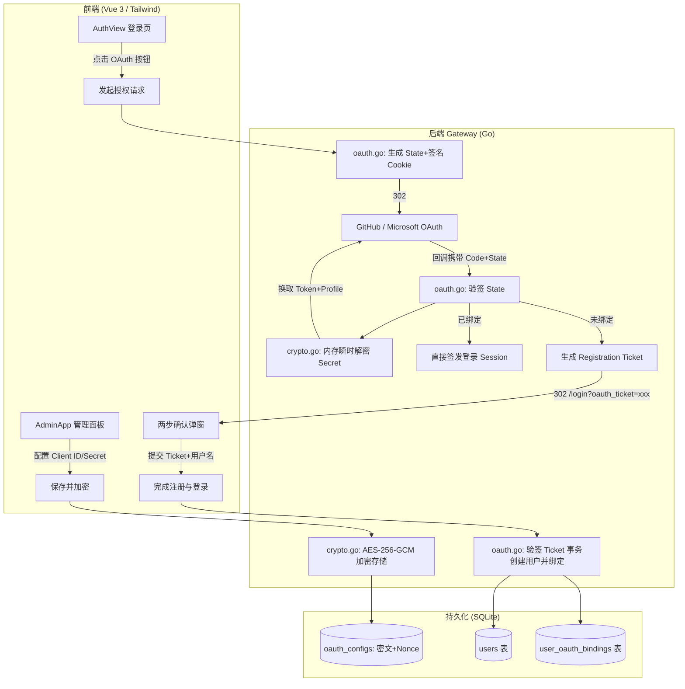

# GitHub 与 Outlook (Microsoft) OAuth 第三方认证与两步注册实现计划

> **For agentic workers:** REQUIRED SUB-SKILL: Use superpowers:subagent-driven-development to implement this plan task-by-task. Steps use checkbox (`- [ ]`) syntax for tracking.

**Goal:** 为 AttackBox 登录与注册流程增加 GitHub 与 Outlook 第三方快捷认证支持，结合 AES-256-GCM 安全密文存储、防 CSRF 签名校验与两步注册激活流程。

**Architecture:** 
后端在 `internal/auth` 实现 AES-256-GCM 凭据加密与 SQLite 表扩展 (`oauth_configs`, `user_oauth_bindings`)，在 `internal/gateway` 负责 OAuth 授权时序（State 防伪造签名、Token 与 Profile 换取、单次短效 Registration Ticket 签发与两步建号）；前端在 `AuthView.vue` 呈现第三方快捷按钮并在授权后唤起两步激活弹窗，在 `AdminApp.vue` 提供脱敏凭据配置面板。

**Architecture Diagram:**

**Tech Stack:** Go (1.22+), SQLite (`github.com/mattn/go-sqlite3`), crypto/aes, crypto/cipher, Vue 3, Tailwind CSS, Python (Test Suite).

## Global Constraints
- 严格遵循最小特权与零泄露：Client Secret 绝不以明文存库，管理端 API 永不回显明文 Secret。
- 防 CSRF：State 参数必须携带服务端 HMAC-SHA256 签名并在 HttpOnly Cookie 中隔离比对。
- 用户名格式：第三方建议用户名必须严格经过 `^[a-zA-Z0-9_-]{3,32}$` 规范清洗，避免宿主机 Linux 命名空间异常。
- 保证平滑过渡：若管理员未开启某第三方登录，前端自动灰度隐藏入口；原有账号密码与管理体系 100% 兼容。

---

### Task 1: AES-256-GCM 凭据加密工具与单元测试

**Files:**
- Create: `internal/auth/crypto.go`
- Test: `internal/auth/crypto_test.go`

**Interfaces:**
- Produces:
  - `EncryptSecret(plaintext string, masterKey []byte) (ciphertextB64, nonceB64 string, err error)`
  - `DecryptSecret(ciphertextB64, nonceB64 string, masterKey []byte) (plaintext string, err error)`
  - `DeriveMasterKey() []byte`

- [ ] **Step 1: 编写加密与解密的单元测试**
  在 `internal/auth/crypto_test.go` 中编写针对正常加解密、篡改密文后解密失败、空输入与随机 Nonce 独立性的测试用例。

- [ ] **Step 2: 实现 AES-256-GCM 加解密核心逻辑**
  在 `internal/auth/crypto.go` 中实现 GCM 模式、12 字节随机 Nonce 生成与基于环境变量/系统盐派生的 32 字节 Master Key 逻辑。

- [ ] **Step 3: 验证单元测试通过**
  执行测试确保通过。

---

### Task 2: 数据库表结构扩展与 OAuth 配置/绑定 CRUD

**Files:**
- Modify: `internal/auth/store.go`
- Modify: `internal/auth/store_test.go` (若有)

**Interfaces:**
- Produces:
  - `type OAuthConfig struct { Provider, ClientID, EncryptedSecret, Nonce string; Enabled bool; UpdatedAt time.Time }`
  - `type UserOAuthBinding struct { ID, UserID int64; Provider, ProviderUID, ProviderEmail string; CreatedAt time.Time }`
  - `(s *Store) SaveOAuthConfig(provider, clientID, encryptedSecret, nonce string, enabled bool) error`
  - `(s *Store) GetOAuthConfig(provider string) (*OAuthConfig, error)`
  - `(s *Store) ListOAuthConfigs() ([]*OAuthConfig, error)`
  - `(s *Store) CreateUserWithOAuthBinding(username, password, provider, providerUID, providerEmail string) (*User, error)`
  - `(s *Store) GetUserByOAuth(provider, providerUID string) (*User, error)`

- [ ] **Step 1: 在 `initSchema()` 增加 `oauth_configs` 与 `user_oauth_bindings` 表**
  包含外键级联与唯一索引。

- [ ] **Step 2: 实现配置存储与读取方法**
  增加 `SaveOAuthConfig`, `GetOAuthConfig`, `ListOAuthConfigs`。

- [ ] **Step 3: 实现事务化创建用户与第三方绑定方法**
  实现 `CreateUserWithOAuthBinding` 与 `GetUserByOAuth`，保证用户与绑定关系在同一个 SQLite 事务中落库。

---

### Task 3: 后端 OAuth 授权时序、防 CSRF 验签与两步注册 API

**Files:**
- Create: `internal/gateway/oauth.go`
- Modify: `internal/gateway/server.go`

**Interfaces:**
- Produces:
  - `GET /api/public/oauth-providers`
  - `GET /api/oauth/{provider}/authorize`
  - `GET /api/oauth/{provider}/callback`
  - `POST /api/oauth/complete-registration`
  - `GET /api/admin/oauth/settings`
  - `POST /api/admin/oauth/settings`

- [ ] **Step 1: 编写 Registration Ticket 与 State 签名生成与验证工具**
  使用 HMAC-SHA256 对包含过期时间的 Payload 进行对称签名，防伪造防重放。

- [ ] **Step 2: 实现 GitHub 与 Outlook (Microsoft Graph) 用户身份解析器**
  支持 GitHub API (`/user` & `/user/emails`) 和 Microsoft Graph API (`/v1.0/me`)，换取 token 并解析统一的 `ProviderProfile` (UID, Email, SuggestedUsername)。

- [ ] **Step 3: 实现 OAuth 路由与两步激活端点**
  在 `oauth.go` 中实现 Authorize 重定向、Callback 回跳处理、两步建号完成端点，以及管理后台加密保存端点。在 `server.go` 挂载路由。

---

### Task 4: 前端界面适配与两步建号弹窗 (Vue 3)

**Files:**
- Modify: `frontend/src/views/AuthView.vue`
- Modify: `frontend/src/AdminApp.vue`
- Modify: `frontend/src/components/Navbar.vue` (若需展示已绑定标识)

- [ ] **Step 1: 在 `AuthView.vue` 增加 GitHub 与 Outlook 第三方按钮**
  读取 `/api/public/oauth-providers`，若已开启对应第三方，展示带原生官方矢量图标的极简按钮。

- [ ] **Step 2: 在 `AuthView.vue` 实现两步激活确认弹窗 (OAuth Setup Modal)**
  页面加载时解析 `?oauth_ticket=xxx` 参数；触发弹窗，显示已验证的第三方标识，提供用户名输入（预填推荐值）及可选密码设置，调用 `/api/oauth/complete-registration` 并登录跳转。

- [ ] **Step 3: 在 `AdminApp.vue` 增加 OAuth 凭据管理面板**
  在管理端系统设置区域增加第三方登录配置模块，支持勾选启用、输入 Client ID 与 Client Secret（脱敏展示，保存时触发加密）。

- [ ] **Step 4: 编译前端产物**
  在 `frontend` 执行 `npm run build`，产出编译文件至 `web/dist`。

---

### Task 5: 部署与端到端自动化安全测试套件

**Files:**
- Create: `tests/test_oauth_suite.py`
- Modify: `deploy_sync.sh`

- [ ] **Step 1: 编写 Python 自动化安全与功能测试脚本**
  测试用例包含：
  1. 公开端点 `/api/public/oauth-providers` 灰度感知；
  2. 模拟发起授权并校验 State Cookie 与 HMAC 签名防篡改；
  3. 伪造或过期 Registration Ticket 提交拦截验证；
  4. 验证 SQLite 数据库 `oauth_configs` 中的密文与 Nonce，确认无明文 Secret；
  5. 验证管理端 API 脱敏返回（`client_secret` 绝不回显）。

- [ ] **Step 2: 打包并同步至远程服务器 `laji@77.67.1.106`**
  打包 `update_sync.tar.gz`，SCP 上传并执行 `deploy_sync.sh`。

- [ ] **Step 3: 执行端到端回归与新增测试套件**
  在服务器运行 `tests/test_stage2_suite.py` 与 `tests/test_oauth_suite.py`，确认全部通过。
