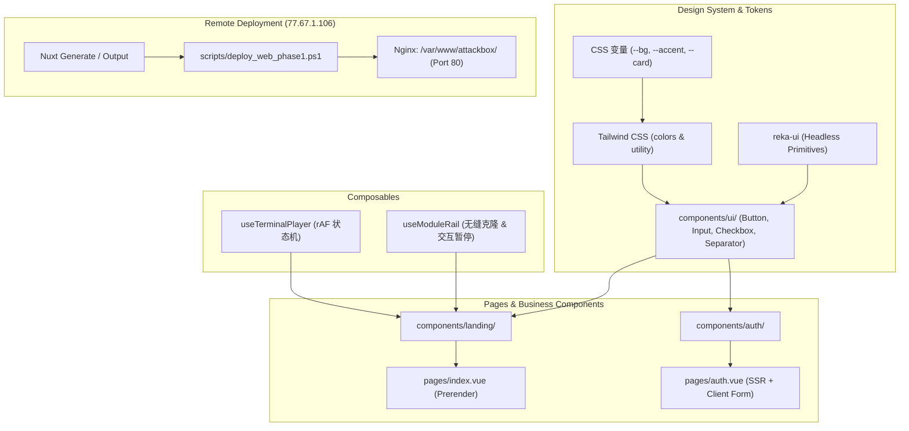

# AttackBox 前端重构 Phase 1 实施计划

> **For agentic workers:** REQUIRED SUB-SKILL: Use superpowers:subagent-driven-development to implement this plan task-by-task. Steps use checkbox (`- [ ]`) syntax for tracking.

**Goal:** 在独立 `web/` 目录下初始化 Nuxt 3 + TypeScript + Tailwind CSS + Reka UI 前端工程，实现完整的 CSS 变量设计系统与动效 Composable，完成品牌首页与认证中心的像素级迁入，并打包部署至远程服务器 `ssh laji@77.67.1.106`（`/var/www/attackbox/`）供用户验收。

**Architecture:** Nuxt 3 采用混合渲染模式，品牌首页进行预渲染（Prerender）以保证最佳 SEO 与秒开性能，认证页面采用 SSR + 客户端响应式交互。UI 体系严格解耦：底层为 Reka UI 无样式原子组件与 Tailwind CSS 变量映射；业务层拆分为 Landing 与 Auth 领域组件；复杂生命周期与动效（终端演练状态机、模块架平滑无缝循环）收敛至专属 Vue Composables。最后通过自动化部署脚本将静态产物与资源同步至远程服务器由 Nginx 承载。

**Architecture Diagram:**



**Tech Stack:**
- Nuxt 3 (`^3.15.x`), Vue 3 (`^3.5.x`)
- TypeScript (`strict: true`)
- Tailwind CSS (`@nuxtjs/tailwindcss ^6.13.x`)
- Reka UI (`reka-ui ^2.x` 与 `reka-ui/nuxt`)
- Lucide Icons (`lucide-vue-next ^0.470.x`)
- Target Server: `ssh laji@77.67.1.106` (Nginx + Node.js v20.19.2)

## Global Constraints
- 前端独立工作目录：`F:\deepseek\attackbox\web`
- 绝不在根目录或旧 `frontend/` 直接混写代码，保持现有 Go 控制台可运行
- 严禁硬编码颜色值，所有颜色必须通过 `var(--*)` CSS 变量与 Tailwind 语义类引用
- 终端与轨道动效必须在组件卸载时完全释放监听与帧句柄，严防内存泄漏
- 遵守用户全局规则：非破坏性操作直接执行，Git 提交与包安装需预先确认

---

### Task 1: 初始化 Nuxt 3 脚手架与核心配置

**Files:**
- Create: `web/package.json`
- Create: `web/nuxt.config.ts`
- Create: `web/tsconfig.json`
- Create: `web/app.vue`
- Create: `web/public/favicon.svg`

**Interfaces:**
- Consumes: Node.js runtime environment (v24 host, v20 remote)
- Produces: 可编译运行的 Nuxt 3 骨架与类型声明

- [ ] **Step 1: 创建 `web/package.json` 并声明依赖**

```json
{
  "name": "attackbox-web",
  "private": true,
  "type": "module",
  "scripts": {
    "build": "nuxt build",
    "generate": "nuxt generate",
    "dev": "nuxt dev",
    "preview": "nuxt preview",
    "postinstall": "nuxt prepare"
  },
  "dependencies": {
    "lucide-vue-next": "^0.475.0",
    "reka-ui": "^2.0.1",
    "vue": "^3.5.13"
  },
  "devDependencies": {
    "@nuxtjs/tailwindcss": "^6.13.1",
    "nuxt": "^3.15.4",
    "tailwindcss": "^3.4.17",
    "typescript": "^5.7.3"
  }
}
```

- [ ] **Step 2: 创建 `web/nuxt.config.ts`**

```typescript
// https://nuxt.com/docs/api/configuration/nuxt-config
export default defineNuxtConfig({
  compatibilityDate: '2024-11-01',
  devtools: { enabled: false },
  modules: [
    '@nuxtjs/tailwindcss',
    'reka-ui/nuxt'
  ],
  css: [
    '~/assets/css/main.css',
    '~/assets/css/animations.css'
  ],
  routeRules: {
    '/': { prerender: true },
    '/auth': { ssr: true }
  },
  app: {
    head: {
      title: 'AttackBox — 理解原理，亲手验证。',
      meta: [
        { charset: 'utf-8' },
        { name: 'viewport', content: 'width=device-width, initial-scale=1' },
        { name: 'description', content: '理解原理，亲手验证。在 AttackBox 探索安全学习与实践。' }
      ],
      link: [
        { rel: 'icon', type: 'image/svg+xml', href: '/favicon.svg' }
      ]
    }
  }
})
```

- [ ] **Step 3: 创建 `web/tsconfig.json` 与 `web/app.vue`**

```json
{
  // https://nuxt.com/docs/guide/concepts/typescript
  "extends": "./.nuxt/tsconfig.json"
}
```

```vue
<template>
  <div class="min-h-screen bg-background text-foreground antialiased selection:bg-accent/25 selection:text-foreground">
    <NuxtLayout>
      <NuxtPage />
    </NuxtLayout>
  </div>
</template>
```

- [ ] **Step 4: 创建 `web/public/favicon.svg`**

从 `prototypes/landing-page/index.html` 提取 SVG favicon 并写入 `web/public/favicon.svg`。

- [ ] **Step 5: 安装依赖并验证脚手架编译**

执行命令：
`cd web && npm install`
验证命令：
`cd web && npx nuxi prepare`
预期输出：`.nuxt` 目录生成成功，类型检查就绪。

---

### Task 2: 样式系统 Token、动画与 Reka UI 原子基础组件

**Files:**
- Create: `web/assets/css/main.css`
- Create: `web/assets/css/animations.css`
- Create: `web/tailwind.config.ts`
- Create: `web/components/ui/Button.vue`
- Create: `web/components/ui/Input.vue`
- Create: `web/components/ui/Checkbox.vue`
- Create: `web/components/ui/Separator.vue`

**Interfaces:**
- Consumes: Tailwind CSS, Reka UI Primitives
- Produces: 全局统一的设计 Token 与基础组件库

- [ ] **Step 1: 编写 `web/assets/css/main.css` 与 `animations.css`**

写入规范中确认的深海暗色 CSS 变量、石墨亮色模式、字体和重置样式。并在 `animations.css` 中声明打字机光标闪烁（`@keyframes blink`）与加载圆点旋转（`@keyframes spin`）。

- [ ] **Step 2: 编写 `web/tailwind.config.ts` 映射 CSS 变量**

将 `background`, `card`, `input`, `foreground`, `muted`, `line`, `accent`, `error` 映射至 `var(--*)`。

- [ ] **Step 3: 封装 `web/components/ui/Button.vue`**

支持 `variant`（`primary`, `outline`, `ghost`）、`loading`、多态 `as`（原生 button 或 NuxtLink），严格复刻原型中按键的内边距、圆角与悬停微交互。

- [ ] **Step 4: 封装 `web/components/ui/Input.vue`**

集成原生 input，支持密码显隐眼睛按钮切换、CapsLock 大写锁定监听提示、`aria-invalid` 动态关联 `field-error` 文本。

- [ ] **Step 5: 封装 `web/components/ui/Checkbox.vue` 与 `Separator.vue`**

基于 `reka-ui` 的 `CheckboxRoot` + `CheckboxIndicator` 和 `Separator`，还原 13x13 珊瑚色选中框与居中带文字分割线。

- [ ] **Step 6: 验证组件库在 Nuxt 中的类型推导与编译**

执行：`cd web && npx nuxi typecheck || npm run build`
预期输出：零编译报错。

---

### Task 3: 动效 Composable 封装 (终端演练状态机与模块架循环)

**Files:**
- Create: `web/composables/useTerminalPlayer.ts`
- Create: `web/composables/useModuleRail.ts`
- Create: `web/tests/composables.test.ts` (基于 Node 原生测试验证剧本与状态流转)

**Interfaces:**
- Consumes: Browser DOM API (`requestAnimationFrame`, `ResizeObserver`, `IntersectionObserver`)
- Produces: 响应式状态与控制器给 Landing 组件消费

- [ ] **Step 1: 编写终端演练状态机测试**

验证 `useTerminalPlayer` 的剧本切换逻辑、字符截取算法以及时间片步进。

- [ ] **Step 2: 实现 `web/composables/useTerminalPlayer.ts`**

迁移 `prototypes/landing-page/src/scene.js` 中的 `nmap`、`smb`、`msf` 剧本。
实现 `typing` → `execute` → `output` → `hold` → `clear` 响应式流转。
接入 `document.visibilityState` / `pagehide` 监听与 `prefers-reduced-motion` 适配。
提供 `onUnmounted` 自动清理销毁逻辑。

- [ ] **Step 3: 实现 `web/composables/useModuleRail.ts`**

封装横向循环轨道的平滑自增步进逻辑，克隆节点生成（追加 `aria-hidden="true"`, `tabindex="-1"`），鼠标悬停（`pointerenter`）、键盘聚焦（`focusin`）即时暂停，触控手势（`touchmove`, `wheel`）2800ms 后平滑恢复。

- [ ] **Step 4: 运行单元测试验证**

执行：`node --test web/tests/composables.test.ts`
预期输出：测试全部 PASS。

---

### Task 4: 落地页业务组件与预渲染落地页 (`/`)

**Files:**
- Copy: `prototypes/landing-page/assets/*.jpg` → `web/assets/images/`
- Create: `web/components/landing/TerminalBackdrop.vue`
- Create: `web/components/landing/HeroSection.vue`
- Create: `web/components/landing/FeaturedModule.vue`
- Create: `web/components/landing/ModuleRail.vue`
- Create: `web/layouts/landing.vue`
- Create: `web/pages/index.vue`

**Interfaces:**
- Consumes: `useTerminalPlayer`, `useModuleRail`, `Button.vue`
- Produces: 完整的品牌首屏与模块架静态预渲染页面

- [ ] **Step 1: 复制图片资产至 `web/assets/images/`**

拷贝 `linux.jpg`、`network.jpg`、`web.jpg`，并在 Nuxt 中通过 `~/assets/images/*` 引用。

- [ ] **Step 2: 实现 `TerminalBackdrop.vue`**

挂载终端屏幕层与模糊光晕层（`radial-gradient`），绑定 `useTerminalPlayer` 导出的行数组、当前键入命令与闪烁光标。

- [ ] **Step 3: 实现 `FeaturedModule.vue` 与 `ModuleRail.vue`**

构建主推云原生攻防卡片（含集群 SVG 拓扑线框图），构建横向无缝轨道卡片列表，卡片集成鼠标反光移动侦测（更新 `--mx`, `--my` 变量）。

- [ ] **Step 4: 实现 `HeroSection.vue`、`layouts/landing.vue` 与 `pages/index.vue`**

组装完整落地页，顶部导航包含品牌和“进入平台 ↗”（链接至 `/auth`），首屏居中主标题与暖色渐变（`warm-gradient`），行动按钮链接至 `/auth`。

- [ ] **Step 5: 验证本地预渲染与静态产物输出**

执行：`cd web && npm run generate`
预期输出：`web/.output/public/index.html` 生成，且包含预渲染的 HTML 结构。

---

### Task 5: 认证中心业务组件与认证页 (`/auth`)

**Files:**
- Create: `web/components/auth/AuthVisualAside.vue`
- Create: `web/components/auth/LoginForm.vue`
- Create: `web/components/auth/RegisterForm.vue`
- Create: `web/components/auth/RecoverForm.vue`
- Create: `web/layouts/auth.vue`
- Create: `web/pages/auth.vue`

**Interfaces:**
- Consumes: `Button.vue`, `Input.vue`, `Checkbox.vue`, `Separator.vue`
- Produces: 支持登录、注册、密码找回切换的全功能认证页面

- [ ] **Step 1: 实现 `AuthVisualAside.vue`**

复刻原型左侧微倾斜终端艺术字（`nmap done`, `smbclient`）与“让好奇，有迹可循”标语，响应式断点 `<= 760px` 自动隐藏。

- [ ] **Step 2: 实现 `LoginForm.vue`、`RegisterForm.vue` 与 `RecoverForm.vue`**

实现客户端邮箱正则、密码最少 6 位校验；错误自动聚焦首个非法输入框；第三方入口（GitHub / 单点登录）交互反馈；保持登录状态 Checkbox；提交后模拟 650ms 延迟展示成功预览卡片。

- [ ] **Step 3: 实现 `layouts/auth.vue` 与 `pages/auth.vue`**

通过 `route.query.mode` 联动渲染三种表单状态；页面标题根据模式动态更新；提供返回首页入口。

- [ ] **Step 4: 验证客户端无刷新切换与表单交互**

执行：`cd web && npm run build`
预期输出：成功打包，路由无报错。

---

### Task 6: 部署自动化脚本与远程部署至 `77.67.1.106`

**Files:**
- Create: `scripts/deploy_web_phase1.ps1`
- Target: `ssh laji@77.67.1.106` (`/var/www/attackbox/`)

**Interfaces:**
- Consumes: `web/.output/public/` 静态构建产物
- Produces: 部署至远程 Nginx 站点根目录，对外提供公网访问

- [ ] **Step 1: 编写部署脚本 `scripts/deploy_web_phase1.ps1`**

脚本逻辑：
1. 本地执行 `cd web; npm run generate` 生成全量静态静态站产物（`.output/public`）。
2. 在本地将 `.output/public` 打包为 `web_dist.tar.gz`。
3. 通过 `scp` 传输 `web_dist.tar.gz` 到 `laji@77.67.1.106:/home/laji/`。
4. 通过 `ssh -n laji@77.67.1.106` 解压并同步到 `/var/www/attackbox/`（保留原旧版备份到 `/var/www/attackbox_legacy/`）。
5. 执行 `sudo nginx -s reload` 重载站点。
6. 测试远端响应状态码。

- [ ] **Step 2: 执行部署脚本发布到远端**

执行：`powershell -ExecutionPolicy Bypass -File scripts/deploy_web_phase1.ps1`
预期输出：传输完成，Nginx 重载成功，`http://77.67.1.106/` 返回 HTTP 200。

---

### Task 7: 远程服务实机验收与交付测试

**Files:**
- Test target: `http://77.67.1.106/` 与 `http://77.67.1.106/auth`

**Interfaces:**
- Produces: 验收测试报告，交付用户亲自体验

- [ ] **Step 1: 执行 HTTP 端点健康检查**

检查首页 `http://77.67.1.106/` 与认证页 `http://77.67.1.106/auth` 的响应头、静态资产加载。

- [ ] **Step 2: 验证动效与交互完整性**

通过浏览器访问远端：
1. 首页终端打字机自动循环、暂停与清屏。
2. 模块架自动循环移动，悬停暂停，滑动正常。
3. 认证页面登录/注册/找回密码切换顺畅，密码眼睛、大写锁定提醒生效。
4. 移动端视口（使用 DevTools 模拟 360px、390px、768px）布局无溢出。

- [ ] **Step 3: 提供用户验收清单与测试入口**

提交完整的交付说明与在线体验入口。
