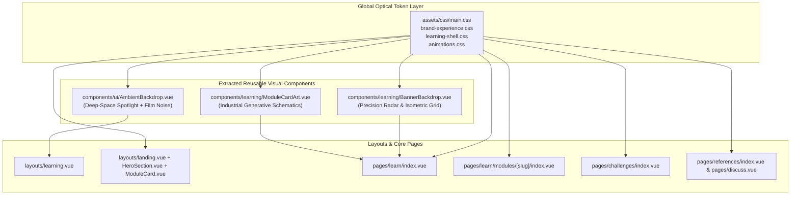

# AttackBox Frontend Visual & Spatial Hierarchy Implementation Plan

> **For agentic workers:** REQUIRED SUB-SKILL: Use superpowers:subagent-driven-development to implement this plan task-by-task. Steps use checkbox (`- [ ]`) syntax for tracking.

**Goal:** Upgrade AttackBox's frontend visual system to the Carbon & Industrial Signal Orange (`#09090b` + `#fafafa` + `#f97316`) aesthetic with a 5-tier optical elevation hierarchy, modularize bloated backdrop/card-art templates into reusable Vue components, and purge legacy circuit-grid and RPG-dragon dead code.

**Architecture:** We establish a 5-tier optical token system (`Level -1 Well` -> `Level 0 Canvas` -> `Level +1 Elevated Surface` -> `Level +2 Specular Hover`) in `assets/css/main.css`, `brand-experience.css`, and `learning-shell.css` while preserving backward-compatible token fallbacks required by existing unit/E2E tests. We extract two focused reusable visual components (`components/ui/AmbientBackdrop.vue` for the pure deep-space spotlight + film-grain canvas and `components/learning/ModuleCardArt.vue` for precision industrial module schematics) to eliminate hundreds of lines of inline SVG clutter across layouts and pages.

**Architecture Diagram:**



**Tech Stack:** Nuxt 3, Vue 3 SFC (`<script setup lang="ts">`), Scoped CSS + CSS Custom Properties, Tailwind CSS, Node.js native test runner (`node:test`).

## Global Constraints

- Zero duplicate CSS selectors within the same cascade context (enforced by `web/tests/styles.test.js`).
- Preserve legacy fallback variable declarations in `web/assets/css/main.css` (`--bg-app: #090a0e;`, `--accent-coral: #ffaf88;`, etc.) so `web/tests/ui.test.js` passes without regression.
- Isolate `.auth-layout` in `web/assets/css/brand-experience.css` so `web/tests/landing-browser.test.mjs` still observes `rgb(242, 240, 237)`, `rgb(21, 21, 27)`, and `rgb(242, 232, 223)` on `/auth`.
- Keep `.feature-banner` height `< 190px` on desktop (`min-height: 168px; max-height: 184px`) so `web/tests/module-cover-browser.test.mjs` passes.
- Keep `.site-header` height at `56px` and `.learning-frame` max-width at `1360px` so `web/tests/learning-shell-browser.test.mjs` passes.

---

### Task 1: Global Carbon & Signal Orange Optical Tokens and Dead CSS Cleanup

**Files:**
- Modify: `web/assets/css/main.css`
- Modify: `web/assets/css/brand-experience.css`
- Modify: `web/assets/css/learning-shell.css`
- Modify: `web/assets/css/markdown.css`
- Modify: `web/assets/css/animations.css`
- Test: `web/tests/ui.test.js`
- Test: `web/tests/styles.test.js`

**Interfaces:**
- Produces CSS custom properties: `--bg`, `--surface-well`, `--well-shadow`, `-- well-border`, `--paper`, `--soft`, `--hover`, `--ink`, `--body`, `--muted`, `--line`, `--line-strong`, `--brand`, `--brand-soft`, `--brand-border`, `--card-surface`, `--surface-highlight`, `--card-shadow`, `--card-hover-shadow`, `--backdrop-glow`, `--backdrop-secondary-glow`.
- Purges dead CSS keyframes `beam-flow`, `beam-flow-reverse`, `node-pulse` from `animations.css` and dead variables `--grid-major`, `--grid-minor`, `--grid-cross`, `--beam-warm`, `--beam-cool`, `--beam-silver` from `main.css`.

- [ ] **Step 1: Add token verification assertions to `web/tests/ui.test.js`**

Update `web/tests/ui.test.js` to assert that the new Carbon & Signal Orange optical elevation tokens (`--surface-well`, `--well-shadow`, `--brand: #f97316;`, `--bg: #09090b;`) exist alongside the base tokens, and that legacy grid variables (`--grid-major`, `beam-flow`) are removed.

```javascript
// In web/tests/ui.test.js inside test('main.css contains all required design tokens and accessibility rules')
  assert.ok(css.includes('--bg: #09090b;'))
  assert.ok(css.includes('--brand: #f97316;'))
  assert.ok(css.includes('--surface-well:'))
  assert.ok(css.includes('--well-shadow:'))
  assert.ok(!css.includes('--grid-major'))
```

- [ ] **Step 2: Run test to verify it fails**

Run: `node --test tests/ui.test.js` (in `f:\deepseek\attackbox\web`)
Expected: FAIL on `assert.ok(css.includes('--bg: #09090b;'))`

- [ ] **Step 3: Update `main.css`, `brand-experience.css`, `learning-shell.css`, `markdown.css`, and `animations.css`**

Update `web/assets/css/animations.css` to remove unused circuit keyframes:
```css
@keyframes blink {
  50% {
    opacity: 0;
  }
}

@keyframes fadeIn {
  from {
    opacity: 0;
  }
  to {
    opacity: 1;
  }
}

@keyframes surface-rise {
  from {
    opacity: 0;
    transform: translateY(6px);
  }
  to {
    opacity: 1;
    transform: translateY(0);
  }
}
```

Update `web/assets/css/main.css` with the Carbon & Signal Orange 5-tier optical tokens (preserving `--bg-app: #090a0e;` and `--reader-ink` for test contracts).
Update `web/assets/css/brand-experience.css` so `.auth-layout.brand-experience` retains its exact auth test colors while `.landing-layout.brand-experience` uses the crisp Carbon & Signal Orange palette.
Update `web/assets/css/learning-shell.css` and `web/assets/css/markdown.css` to replace `#9c623e` / `#d8a57b` / `rgba(223, 176, 134, ...)` with Signal Orange and neutral zinc tokens.

- [ ] **Step 4: Run tests to verify they pass**

Run: `node --test tests/ui.test.js tests/styles.test.js` (in `f:\deepseek\attackbox\web`)
Expected: PASS

---

### Task 2: Extract Reusable Visual Components & Purge Legacy SVG Art

**Files:**
- Create: `web/components/ui/AmbientBackdrop.vue`
- Create: `web/components/learning/ModuleCardArt.vue`
- Modify: `web/components/learning/BannerBackdrop.vue`
- Modify: `web/layouts/learning.vue`
- Test: `web/tests/learning-ui.test.js`
- Test: `web/tests/styles.test.js`

**Interfaces:**
- `web/components/ui/AmbientBackdrop.vue`: Stateless pure-CSS + inline SVG noise backdrop component (`aria-hidden="true"`).
- `web/components/learning/ModuleCardArt.vue`: Props `{ index: number }`. Renders precision industrial SVG schematics (`radar`, `matrix`, `waveform`, `topology`, `optics`) and the monospace index badge (`01`, `02`, ...).
- `web/components/learning/BannerBackdrop.vue`: Props `{ seed: string }`. Replaces the RPG dragon/hero fantasy SVG with an industrial security radar & isometric hardware telemetry schematic while preserving `.banner-backdrop`, `--banner-accent`, and `<svg>`.

- [ ] **Step 1: Add component existence and cleanup assertions in `web/tests/learning-ui.test.js`**

Add assertions in `web/tests/learning-ui.test.js` verifying `components/ui/AmbientBackdrop.vue` and `components/learning/ModuleCardArt.vue` exist, `layouts/learning.vue` no longer contains `backdrop-circuit`, and `components/learning/BannerBackdrop.vue` no longer contains `rpg-dragon`.

- [ ] **Step 2: Run test to verify it fails**

Run: `node --test tests/learning-ui.test.js` (in `f:\deepseek\attackbox\web`)
Expected: FAIL because `AmbientBackdrop.vue` and `ModuleCardArt.vue` do not exist yet.

- [ ] **Step 3: Implement `AmbientBackdrop.vue`, `ModuleCardArt.vue`, `BannerBackdrop.vue`, and clean up `layouts/learning.vue`**

Create `web/components/ui/AmbientBackdrop.vue` with dual-source ambient spotlights (`--backdrop-glow` and `--backdrop-secondary-glow`) and an ultra-fine SVG `feTurbulence` noise layer (`opacity: 0.024`).
Create `web/components/learning/ModuleCardArt.vue` encapsulating the 5 industrial schematic SVG patterns and the `.art-index-pill` badge.
Rewrite `web/components/learning/BannerBackdrop.vue` with a precision industrial security telemetry & radar schematic SVG using Carbon & Signal Orange (`#f97316`, `#ea580c`, `#38bdf8`, `#10b981`).
Simplify `web/layouts/learning.vue` to render `<UiAmbientBackdrop />`, `<LearningHeader />`, and `<main class="learning-main"><slot /></main>`.

- [ ] **Step 4: Run tests to verify they pass**

Run: `node --test tests/learning-ui.test.js tests/styles.test.js` (in `f:\deepseek\attackbox\web`)
Expected: PASS

---

### Task 3: Redesign Landing Page & Header Navigation with Optical Depth

**Files:**
- Modify: `web/components/SiteHeader.vue`
- Modify: `web/components/learning/LearningHeader.vue`
- Modify: `web/layouts/landing.vue`
- Modify: `web/components/landing/HeroSection.vue`
- Modify: `web/components/landing/FeaturedModule.vue`
- Modify: `web/components/landing/ModuleRail.vue`
- Modify: `web/components/landing/ModuleCard.vue`
- Modify: `web/pages/index.vue`
- Test: `web/tests/landing.test.js`
- Test: `web/tests/styles.test.js`

**Interfaces:**
- Preserves all DOM classes and links checked by `web/tests/landing.test.js` and `web/tests/landing-browser.test.mjs` (`.site-header` 56px height, `.featured-module`, `.module-card`, `.catalog-empty`, `to="/learn"`).

- [ ] **Step 1: Add landing optical token assertions to `web/tests/landing.test.js`**

Update `web/tests/landing.test.js` to verify that `FeaturedModule.vue` and `ModuleCard.vue` no longer use the legacy muddy brown hexes (`#d8a57b`, `#c1a381`) and instead use the Carbon & Signal Orange palette.

- [ ] **Step 2: Run test to verify it fails**

Run: `node --test tests/landing.test.js` (in `f:\deepseek\attackbox\web`)
Expected: FAIL on legacy hex check.

- [ ] **Step 3: Upgrade `SiteHeader.vue`, `LearningHeader.vue`, `landing.vue`, `HeroSection.vue`, `FeaturedModule.vue`, `ModuleRail.vue`, `ModuleCard.vue`, and `pages/index.vue`**

- In `SiteHeader.vue` and `LearningHeader.vue`: Add crisp bottom specular border (`rgba(255, 255, 255, 0.08)`) and Signal Orange active navigation indicator with subtle glow.
- In `HeroSection.vue`: Remove the coarse 4px `repeating-linear-gradient` scanline; add a top radial spotlight and a sleek industrial status pill (`ATTACKBOX // LIVE LAB ENVIRONMENT`) with a glowing Signal Orange dot above `<h1>`; style `.warm` with a crisp white-to-signal-orange metallic gradient; upgrade `.primary` CTA button with high-contrast pure white surface, top specular rim, and hover glow.
- In `FeaturedModule.vue`, `ModuleRail.vue`, `ModuleCard.vue`, and `pages/index.vue`: Replace muddy brown/purple tones with Carbon & Signal Orange industrial tones (`#f97316`, `#e4e4e7`, `#38bdf8`, `#10b981`, `#a1a1aa`), add top 1px specular highlight rims (`box-shadow: var(--surface-highlight), var(--card-shadow)`), and refine typography contrast.

- [ ] **Step 4: Run tests to verify they pass**

Run: `node --test tests/landing.test.js tests/styles.test.js` (in `f:\deepseek\attackbox\web`)
Expected: PASS

---

### Task 4: Upgrade Platform Catalog & Detail Pages with Recessed Wells and Elevated Cards

**Files:**
- Modify: `web/components/learning/HomeCarousel.vue`
- Modify: `web/pages/learn/index.vue`
- Modify: `web/pages/learn/modules/[slug]/index.vue`
- Modify: `web/pages/challenges/index.vue`
- Modify: `web/pages/references/index.vue`
- Modify: `web/pages/discuss.vue`
- Test: `web/tests/learning-ui.test.js`
- Test: `web/tests/styles.test.js`

**Interfaces:**
- Consumes `<LearningModuleCardArt :index="index" />` in `web/pages/learn/index.vue`.
- Consumes `--surface-well`, `--well-shadow`, `--card-surface`, `--surface-highlight`, `--card-shadow`, `--card-hover-shadow` across all 5 pages.

- [ ] **Step 1: Update `web/tests/learning-ui.test.js` to verify componentization of `pages/learn/index.vue`**

Assert in `web/tests/learning-ui.test.js` that `pages/learn/index.vue` uses `LearningModuleCardArt` while keeping `card-art`, `page-tabs`, and `cards`.

- [ ] **Step 2: Run test to verify it fails**

Run: `node --test tests/learning-ui.test.js` (in `f:\deepseek\attackbox\web`)
Expected: FAIL because `pages/learn/index.vue` does not yet use `LearningModuleCardArt`.

- [ ] **Step 3: Refactor `pages/learn/index.vue`, `HomeCarousel.vue`, `pages/learn/modules/[slug]/index.vue`, `pages/challenges/index.vue`, `pages/references/index.vue`, and `pages/discuss.vue`**

- `pages/learn/index.vue`: Replace the 120-line inline SVG block inside `.card-art` with `<LearningModuleCardArt :index="index" />`; place `.filters` inside a recessed well container (`background: var(--surface-well); box-shadow: var(--well-shadow); padding: 4px; border-radius: 10px`); upgrade `.recent-learning` with a Signal Orange left accent bar and elevated surface; refine `.card` and `.published-route` with specular top rims and deep shadows.
- `HomeCarousel.vue`: Refine `.feature-banner` surface and typography while keeping height `< 190px`.
- `pages/learn/modules/[slug]/index.vue`: Upgrade `.hero-section` into an elevated spotlight banner; wrap `.chapter-list` in a recessed well tray (`--surface-well`) with elevated `.chapter-row` items and monospace `.chapter-number` badges; refine `.support-section` sidebar cards.
- `pages/challenges/index.vue`: Wrap `.filters` in a recessed well bar; upgrade `.card` with difficulty-colored subtle top glow and specular rim.
- `pages/references/index.vue`: Transform `.reference-list` from flat `border-bottom` rows into a stacked list of elevated optical cards (`gap: 12px`) with recessed icon badges and hover elevation.
- `pages/discuss.vue`: Upgrade `.discuss-card` with Carbon & Signal Orange spotlight depth and crisp metallic borders.

- [ ] **Step 4: Run full unit and style audit test suite**

Run: `node --test tests/styles.test.js tests/ui.test.js tests/landing.test.js tests/learning-ui.test.js` (in `f:\deepseek\attackbox\web`)
Expected: All tests PASS with zero errors.
