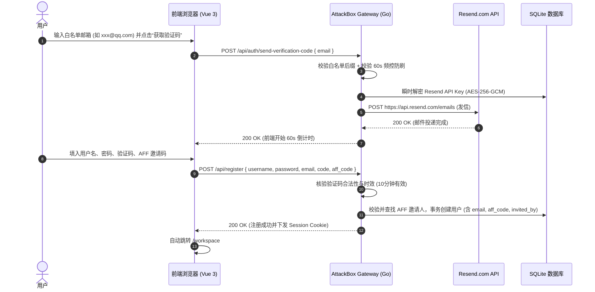

# 设计规格说明书：AFF 邀请码机制与 Resend 邮箱白名单注册系统

## 1. 概述与设计目标
为 AttackBox 靶场工作台构建完整的用户邀请追踪（AFF Affiliate）体系，并实施基于白名单邮箱强校验的自主注册机制。集成 Resend.com 邮件分发服务，敏感 API Key 严格采用 AES-256-GCM 密文存储，杜绝任何磁盘明文落地；严格过滤并屏蔽一切临时/不可信邮箱，仅放行 QQ 邮箱、谷歌邮箱与微软 Outlook 邮箱。

---

## 2. 核心架构与安全模型

### 2.1 API Key 零落地与密文封存
- **落库加密**：管理员在后台配置 Resend API Key 与发信人时，服务端使用系统派生的主密钥及每次独立的 12 字节高熵随机 Nonce 执行 `AES-256-GCM` 密文持久化。
- **零回显 (Zero-Echo)**：管理端查询端点永不反显 API Key 明文，仅返回掩码（如 `re_••••••••`）与已配置状态；
- **内存瞬时解密**：仅在发信触发的短暂毫秒级生命周期内解密出原始 Key，用完立即由垃圾回收销毁，无任何临时明文文件或全局变量常驻。

### 2.2 严格邮箱白名单与防刷门控
- **邮箱域名白名单**：
  - **QQ 邮箱**：`@qq.com`, `@foxmail.com`
  - **谷歌邮箱**：`@gmail.com`, `@googlemail.com`
  - **Outlook / 微软邮箱**：`@outlook.com`, `@hotmail.com`, `@live.com`, `@msn.com`
  - *非上述后缀一律拒绝发信并拦截注册，提示“仅支持 QQ 邮箱、谷歌邮箱和 Outlook 邮箱”*。
- **验证码安全策略**：
  - 生成 6 位密码学安全数字验证码，内存缓存并绑定 Hash，有效期 10 分钟；
  - 发送冷却：单个邮箱与单个 IP 60 秒内仅允许发送 1 次；单 IP 单日最大发送频次阈值封控，防止接口被作为短信/邮件轰炸机滥用。

### 2.3 AFF 邀请码机制
- **专属 AFF 码**：系统内所有用户（包括既有用户与新注册用户）均分配全局唯一的 8 位大写字母数字邀请码（例如 `AB8X9K2M`）；
- **邀请归因**：
  - 注册链接支持携带参数：`/login?aff=AB8X9K2M`；
  - 注册表单提供“邀请码（可选）”输入框，若通过推广链接进入，前端自动提取并填入该字段；
  - 用户注册成功后，在数据库 `users` 表写入 `invited_by_aff_code` 与 `invited_by_user_id`，完整保留邀请归属链条；
- **用户自查看板**：在个人中心的 `ACCOUNT` 页面清晰展示“我的专属邀请链接”及一键复制按钮。

---

## 3. 业务交互时序



---

## 4. 数据库结构变更

### 4.1 `users` 表字段扩展
```sql
ALTER TABLE users ADD COLUMN email TEXT DEFAULT '';
ALTER TABLE users ADD COLUMN aff_code TEXT DEFAULT '';
ALTER TABLE users ADD COLUMN invited_by TEXT DEFAULT '';
CREATE UNIQUE INDEX IF NOT EXISTS idx_users_aff_code ON users(aff_code);
CREATE INDEX IF NOT EXISTS idx_users_email ON users(email);
```

### 4.2 邮件系统设置 (AES-256-GCM)
在 `system_settings` 中通过加密工具安全维护：
- `resend_api_key_enc`: Base64 密文
- `resend_api_key_nonce`: Base64 随机 Nonce
- `resend_from_email`: 发件人地址（如 `AttackBox <onboarding@resend.dev>`）

---

## 5. API 接口定义

| 接口 | 方法 | 鉴权 | 说明 |
| :--- | :--- | :--- | :--- |
| `/api/auth/send-verification-code` | POST | 公开 (限流) | 发送邮箱验证码：`{ email }`，强制白名单后缀与冷却校验 |
| `/api/register` | POST | 公开 | 注册新用户：`{ username, password, email, code, aff_code }` |
| `/api/me` | GET | 需登录 | 响应中补充 `email`、`aff_code`、`invite_link` |
| `/api/admin/resend/settings` | GET | Admin | 查询邮件系统配置状态（脱敏回显，不暴露 API Key） |
| `/api/admin/resend/settings` | POST | Admin | 保存 Resend API Key（AES-256-GCM 加密落库）与发件地址 |

---

## 6. 验收标准
1. **白名单阻断测试**：使用 163、outlook.cn、临时邮箱（如 10minutemail）请求发送验证码，均被立即阻断并给出清晰提示。
2. **白名单放行测试**：输入 `@qq.com`、`@gmail.com`、`@outlook.com` 正常调用 Resend 发信并接收验证码。
3. **AFF 闭环测试**：通过 `?aff=CODE` 打开注册页，自动填入邀请码，注册后数据库正确绑定邀请关系；用户可在 `ACCOUNT` 复制个人邀请链接。
4. **API Key 零落地验证**：直接检索 SQLite 文件和代码仓库，确保绝无任何明文 `re_` 格式字符串。
