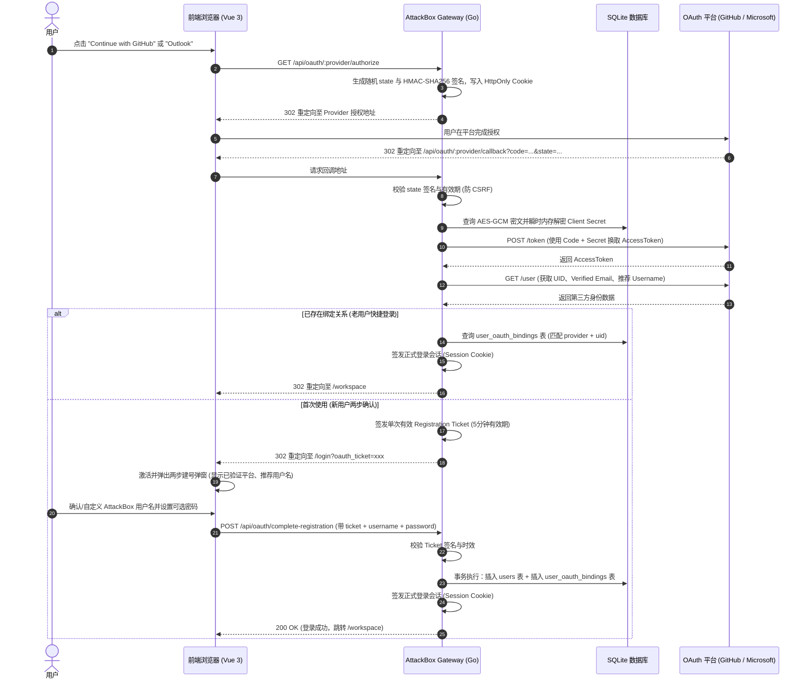

# 设计规格说明书：GitHub 与 Outlook (Microsoft) OAuth 第三方认证与两步注册系统

## 1. 概述与设计目标
为 AttackBox 靶场工作台登录页面提供 GitHub 与 Outlook (Microsoft) 第三方认证能力。遵循“假定宿主机沦陷”与零信任安全原则，对敏感第三方 Client Secret 采用 AES-256-GCM 密文存储，并实现防 CSRF、防重放、两步建号确认及端到端账号绑定的企业级安全认证闭环。

---

## 2. 核心架构与安全模型

### 2.1 凭据安全（AES-256-GCM 密文存储）
- **加密落库**：管理员在管理面板配置第三方 Client ID 与 Client Secret 时，服务端使用 256 位 AES-GCM 算法对 Client Secret 进行实时加密（结合 12 字节高熵随机 Nonce），密文存入数据库 `oauth_configs`。
- **密钥隔离 (Key Derivation)**：主密钥来源于环境隔离参数 `ATTACKBOX_MASTER_KEY` 或由系统管理员安全盐动态派生，杜绝代码硬编码与数据库明文暴露。
- **只写不回显原则**：管理端 API 仅返回是否配置标识（`configured: true`）与脱敏状态，绝对禁止向前端回显 Secret 明文。

### 2.2 授权时序安全（RFC 6749 & 防 CSRF 门控）
- **State HMAC 验签**：发起授权时，服务端动态生成含时间戳的高熵随机串 `state`，结合密钥进行 HMAC-SHA256 签名，存入 `HttpOnly; SameSite=Lax; Secure` 临时 Cookie（有效期 5 分钟）。回调时恒定时间比对，彻底封死登录 CSRF 与账号绑定劫持。
- **Registration Ticket (防伪造建号)**：第三方授权成功后，不直接派发正式 Session。若该第三方 UID 尚未绑定，服务端生成单次有效（5 分钟过期）的加密签名 Ticket，前端凭 Ticket 唤起两步确认弹窗。

---

## 3. 业务流程与交互时序



---

## 4. 数据库表结构变更

### 4.1 OAuth 配置表 `oauth_configs`
```sql
CREATE TABLE IF NOT EXISTS oauth_configs (
    provider TEXT PRIMARY KEY,           -- 'github' 或 'outlook'
    client_id TEXT NOT NULL,             -- 开放平台应用 ID
    encrypted_secret TEXT NOT NULL,      -- AES-256-GCM 加密后的 Secret (base64)
    nonce TEXT NOT NULL,                 -- 12 字节随机 Nonce (base64)
    enabled INTEGER NOT NULL DEFAULT 0,  -- 是否启用该登录方式
    updated_at DATETIME DEFAULT CURRENT_TIMESTAMP
);
```

### 4.2 用户第三方绑定表 `user_oauth_bindings`
```sql
CREATE TABLE IF NOT EXISTS user_oauth_bindings (
    id INTEGER PRIMARY KEY AUTOINCREMENT,
    user_id INTEGER NOT NULL REFERENCES users(id) ON DELETE CASCADE,
    provider TEXT NOT NULL,              -- 'github' 或 'outlook'
    provider_uid TEXT NOT NULL,          -- 第三方平台全局唯一用户 ID (如 GitHub ID / Microsoft OID)
    provider_email TEXT,                 -- 平台认证邮箱
    created_at DATETIME DEFAULT CURRENT_TIMESTAMP,
    UNIQUE(provider, provider_uid)
);
CREATE INDEX IF NOT EXISTS idx_oauth_provider_uid ON user_oauth_bindings(provider, provider_uid);
```

---

## 5. API 接口定义

| 接口 | 方法 | 鉴权 | 说明 |
| :--- | :--- | :--- | :--- |
| `/api/public/oauth-providers` | GET | 公开 | 返回已启用的第三方登录列表（仅返回 `{"providers": ["github", "outlook"]}`） |
| `/api/oauth/:provider/authorize` | GET | 公开 | 发起第三方授权，植入 State 签名 Cookie 并重定向 |
| `/api/oauth/:provider/callback` | GET | 公开 | 授权回调，校验 State，换取用户信息，重定向登录或两步注册 |
| `/api/oauth/complete-registration` | POST | 公开 (需 Ticket) | 提交两步注册：`{ ticket, username, password }`，完成建号与绑定 |
| `/api/admin/oauth/settings` | GET | Admin | 查询 OAuth 启停与配置状态（脱敏，Secret 永不回显） |
| `/api/admin/oauth/settings` | POST | Admin | 写入/更新 OAuth 配置（触发 AES-256-GCM 加密落库） |

---

## 6. 前端 UI 与交互规格
- **登录卡片优化**：
  - 在原登录/注册表单底部新增 `div.relative.my-5` 分割线，居中展示 `OR`；
  - 并排呈现 `GitHub` 与 `Outlook` 黑色极简描边按钮（带平台原生轻量矢量图标）；
  - 支持灰度感知：若管理员后台未配置或未启用某平台，对应按钮自动隐藏。
- **两步确认弹窗 (OAuth Setup Modal)**：
  - 授权返回后，检测到 `oauth_ticket` 自动遮罩弹出；
  - 顶部显示：`✓ 已验证 GitHub 账号 (xxx@example.com)`；
  - 输入框 1：`ATTACKBOX USERNAME`（自动填充合法过滤后的推荐账号名，支持用户修改）；
  - 输入框 2：`PASSWORD (OPTIONAL)`（可选设置本地登录密码，不设则未来仅走第三方免密登录）；
  - 按钮：`COMPLETE REGISTRATION`，提交后直接完成登录并自动清除 URL 参数。

---

## 7. 验收标准与测试用例
1. **密文保护测试**：检查 SQLite 数据库文件，确认 `oauth_configs` 中的 Secret 绝非明文，且每次保存时 Nonce 随机刷新。
2. **防 CSRF 测试**：伪造回调 State 或缺少签名 Cookie，后端必须严格拦截并返回 400 Bad Request。
3. **两步激活建号测试**：
   - 篡改 Ticket 内容或超时使用，拦截激活；
   - 正常流程下，能够按用户自选用户名成功创建新账号并在宿主机生成合法用户沙箱；
   - 相同第三方账号再次点击，自动免密直通登录。
4. **管理端脱敏测试**：管理员在后台读取配置时，响应 JSON 绝不包含明文 Secret。
